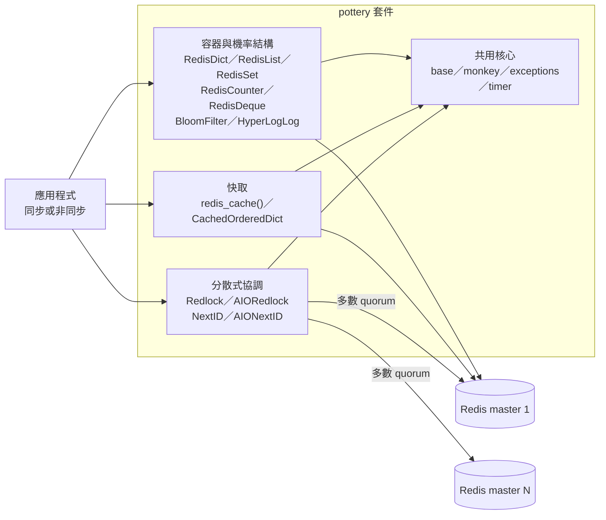
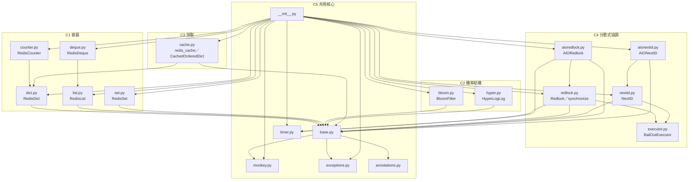

# Pottery 架構總覽

| 項目 | 內容 |
| --- | --- |
| 文件性質 | S6 系統文件：README 與架構總覽（`agent-write-docs`） |
| 對應 Issue | [agent-playground/pottery#12](https://github.com/agent-playground/pottery/issues/12) |
| 基準 | `software-factory` @ `067fcf7` |
| 範圍 | `pottery/` 套件的 as-is 架構、執行時資料流、建置與測試方式 |
| 不在範圍 | 業務規則、規格、未實作功能、缺陷修復、CI 設定變更 |
| 語言 | 繁體中文 |

> 本文件描述**目前程式碼的實際行為**，不是需求規格，也不是 ADR（架構決策紀錄）。
> 依工廠流程文件 `docs/29` §10.2（software-factory repo），`agent-write-docs` 依程式碼寫出的文件**不得**當作
> `agent-write-spec` 的規格來源；需要規格時，仍須由領域專家撰寫或逐條確認業務規則。
> 文中標示「**推斷，待人類確認**」的段落，是從程式碼與測試回推的設計意圖，尚未經人類裁定。

---

## 1. 系統脈絡

### 1.1 定位

`pottery` 是單一 Python 發佈套件（`setup.py:33-34`，版本 `3.0.1`），把 Redis 命令包裝成：

1. **Python 原生容器**：`RedisDict`、`RedisList`、`RedisSet`、`RedisCounter`、`RedisDeque`。
2. **機率結構**：`BloomFilter`、`HyperLogLog`。
3. **快取工具**：`redis_cache()` 裝飾器、`CachedOrderedDict`。
4. **分散式協調 primitive**：`Redlock`、`AIORedlock`、`NextID`、`AIONextID`、`synchronize()`。
5. **輔助工具**：`ContextTimer`、`PotteryEncoder` 與例外／警告階層。

套件沒有命令列入口、沒有服務行程；使用方式是讓應用程式行程建立 Redis client 後，直接建立上述物件。`pottery/__init__.py:58-90` 的 `__all__` 是目前公開 API 的契約，共 28 個名稱。

### 1.2 執行環境與外部相依



- 容器與快取使用呼叫者傳入的單一 Redis client；未傳入時使用 `base._default_redis`。預設 URL 來自環境變數 `REDIS_URL`，未設定時是 `redis://localhost:6379/0`，連線 `socket_timeout=1`（`pottery/base.py:52-53`）。
- 分散式 primitive 接受一組 `masters`，以多數決（`n // 2 + 1`）判斷是否達成 quorum（`pottery/base.py:320-331`）。同步 primitive 的 `masters` 預設為 `{_default_redis}`（`pottery/base.py:300`）；`AIORedlock` 必須明確傳入 `masters`，`AIONextID` 的預設是空集合，實務上也必須傳入（`pottery/base.py:334-337`、`pottery/aionextid.py:50-58`）。
- 直接執行期相依是 `redis>=4.2.0rc1`、`mmh3`、`typing_extensions`（`setup.py:72`）。測試另用 `pytest`、`pytest-asyncio`、`pytest-cov` 與 `uvloop`，全部釘在 `requirements.txt`。

### 1.3 公開 API 分組

| 分組 | 名稱 |
| --- | --- |
| 容器 | `RedisDict`、`RedisList`、`RedisSet`、`RedisCounter`、`RedisDeque` |
| 機率結構 | `BloomFilter`、`HyperLogLog` |
| 快取 | `redis_cache`、`CachedOrderedDict` |
| 分散式協調 | `Redlock`、`AIORedlock`、`synchronize`、`NextID`、`AIONextID` |
| 工具與序列化 | `ContextTimer`、`PotteryEncoder` |
| 容器例外／警告 | `PotteryError`、`KeyExistsError`、`RandomKeyError`、`QueueEmptyError`、`PotteryWarning`、`InefficientAccessWarning` |
| primitive 例外 | `PrimitiveError`、`QuorumIsImpossible`、`QuorumNotAchieved`、`TooManyExtensions`、`ExtendUnlockedLock`、`ReleaseUnlockedLock` |

> `QueueEmptyError` 目前有匯出，但這個版本沒有對應的 `RedisQueue` 實作；本文件不把它描述成可用的容器功能。

---

## 2. 容器與模組

### 2.1 模組依賴圖

下圖只畫 `pottery/` 內的 import 邊；`redis`、`mmh3`、`typing_extensions` 是外部相依。



### 2.2 模組職責

| 模組 | Context | 職責 | 主要對外符號 |
| --- | --- | --- | --- |
| `dict.py` | C1 | 以 Redis hash 實作 `MutableMapping`；key 與 value 都經 JSON codec | `RedisDict` |
| `list.py` | C1 | 以 Redis list 實作 `MutableSequence`；支援 slice、insert、sort | `RedisList` |
| `set.py` | C1 | 以 Redis set 實作 `MutableSet`；支援聯集／交集／差集 | `RedisSet` |
| `counter.py` | C1 | 繼承 `RedisDict` 的 hash 佈局，實作 `collections.Counter` 與算術 | `RedisCounter` |
| `deque.py` | C1 | 以 `RedisList` 實作 deque；`maxlen` 只存在 client 端 | `RedisDeque` |
| `bloom.py` | C2 | Bloom filter；由 `num_elements` 與 `false_positives` 計算位元數與 hash 次數 | `BloomFilter` |
| `hyper.py` | C2 | Redis HyperLogLog 的 Pythonic 包裝；支援 `union()` | `HyperLogLog` |
| `cache.py` | C3 | `functools.lru_cache()` 風格的 Redis 快取裝飾器，以及可快取元素的 `OrderedDict` | `redis_cache`、`CachedOrderedDict`、`CacheInfo` |
| `redlock.py` | C4 | 同步分散式鎖；Lua 腳本、多 master quorum、租約延長與釋放、`synchronize()` 裝飾器 | `Redlock`、`synchronize`、`Scripts` |
| `aioredlock.py` | C4 | `Redlock` 的非同步版本；重用 `redlock.Scripts` 與類別常數 | `AIORedlock` |
| `nextid.py` | C4 | 同步、單調遞增的分散式 ID 產生器；Lua CAS、多 master quorum | `NextID`、`Scripts` |
| `aionextid.py` | C4 | `NextID` 的非同步版本；重用 `nextid.Scripts` | `AIONextID` |
| `executor.py` | C4 | `ThreadPoolExecutor` 子類；`__exit__()` 不等待未完成的 future，讓 quorum 提前返回 | `BailOutExecutor` |
| `base.py` | C5 | Redis client／key 管理、JSON codec、WATCH 管線、相等比較、primitive 的 quorum 檢查 | `Container`、`Primitive`、`AIOPrimitive`、`random_key` |
| `monkey.py` | C5 | `PotteryEncoder`；import 時全域覆寫 `json.dumps` | `PotteryEncoder`、`logger` |
| `annotations.py` | C5 | 型別別名 | `JSONTypes`、`RedisValues`、`F` |
| `exceptions.py` | C5 | 容器與 primitive 的例外／警告階層 | 12 個例外與警告 |
| `timer.py` | C5 | 毫秒級 wall-clock timer | `ContextTimer` |
| `__init__.py` | C5 | 公開 API 再匯出與 `__all__` | 28 個公開名稱 |
| `py.typed` | C5 | PEP 561 型別標記 | — |

---

## 3. 執行時資料流

### 3.1 容器：一個 key、JSON 值、WATCH／MULTI／EXEC

- 每個容器實例對應一個 Redis key；未指定 key 時，`base._Common.__init__()` 會產生 `pottery:<uuid>` 形式的隨機 key（`pottery/base.py:88-95`、`pottery/base.py:56-77`）。隨機 key 的容器在 `__del__()` 時會 `unlink` 該 key（`pottery/base.py:97-104`），因此**隨機 key 不適合跨行程共享**。
- key 與 value 透過 `_encode()`／`_decode()` 轉成 JSON 字串；編碼時使用 `json.dumps(..., sort_keys=True)`（`pottery/base.py:137-154`）。容器只保存資料，不保存 schema 或參數。
- 需要多個命令原子完成的操作（初始化、`update()`、集合運算、相等比較等）走 `_watch()`：先 `WATCH` 涉及的 key，再 `MULTI`／`EXEC`（`pottery/base.py:185-229`）。`_watch()` 會依 Redis 連線參數（host／port／db）分組，不同 Redis 實例的容器不會被放進同一個 pipeline（`pottery/base.py:206-218`）。
- 底層 Redis 型別：`RedisDict` 用 hash（`dict.py:83`），`RedisList`／`RedisDeque` 用 list，`RedisSet` 用 set，`RedisCounter` 用 `RedisDict` 的 hash 佈局，`BloomFilter` 用 string 的位元（`bloom.py:319` 的 `BITCOUNT`），`HyperLogLog` 用 Redis HLL 命令。

### 3.2 分散式 primitive：key 前綴、Lua、quorum

- key 會加上固定前綴：`Redlock` 是 `redlock:<key>`，`NextID` 是 `nextid:<key>`（`pottery/base.py:312-318`、`pottery/redlock.py:228`、`pottery/nextid.py:141`）。
- `Redlock` 對每個 master 用 `SET`（`nx=True`，key 已存在則失敗）寫入本次持有的 UUID，並用三支 Lua 腳本做「檢查 UUID 後回傳 TTL／延長／刪除」的原子操作（`pottery/redlock.py:76-149`、`pottery/redlock.py:278-313`）。釋放與延長都只會作用在仍持有同一 UUID 的 master 上。
- `NextID` 用一支 Lua 腳本做 CAS：只有當 Redis 中的值小於候選值時才寫入並回傳新值，否則回傳 `nil`（`pottery/nextid.py:55-99`）。同步版本在 `num_tries` 次內重試，用盡後拋 `QuorumNotAchieved`；若 `raise_on_redis_errors=True` 且 master 錯誤數過半，則會先拋 `QuorumIsImpossible`（`pottery/nextid.py:172-181`）。並行競爭下 ID 可能出現空洞（文件的 caveat），但不會重複或倒退（`pottery/nextid.py:100-116`）。
- 同步 `Redlock` 在 `as_completed` 迴圈中一旦取得的 master 數超過半數、且扣除時鐘漂移與已耗時間後租約仍為正，就提前返回 `True`（`pottery/redlock.py:318-353`）；`BailOutExecutor` 讓未完成的 future 不阻塞離開（`pottery/executor.py:26-59`）。
- 非同步 `AIORedlock` 由 `asyncio.as_completed` 收集結果，但 quorum 檢查在迴圈**結束後**才做（`pottery/aioredlock.py:242-267`）；因此它不具備同步路徑的「達成 quorum 即提前返回」行為。這是目前實作的差異，不是本文件宣稱的等價保證。
- 多數 quorum 的門檻是 `> len(masters) // 2`，也就是 `n // 2 + 1` 個 master（`pottery/base.py:326`）。`QuorumIsImpossible` 只在 `raise_on_redis_errors=True` 且 Redis 錯誤數超過半數時拋出；`QuorumNotAchieved` 表示重試後仍未達成 quorum。

### 3.3 同步與非同步

`AIORedlock` 與 `AIONextID` 是同步類別的鏡像，不是共用抽象基底：它們直接重用 `redlock.Scripts`／`nextid.Scripts` 與同步類別的常數（`pottery/aioredlock.py:56-64`、`pottery/aionextid.py:36-40`）。因此：

- 同一組 key 與 master 佈局可被同步與非同步 client 看到；鎖的 value 都是 UUID。
- 同步與非同步的 Lua 腳本註冊是 class-level 的，只註冊一次（`pottery/redlock.py:76-106`、`pottery/nextid.py:55-81`）。
- 兩邊的行為 parity 必須靠測試維持；本文件不宣稱兩者在所有邊界行為完全一致。

### 3.4 快取

- `redis_cache()` 以 `RedisDict` 存放結果，key 未指定時用 `random_key()` 產生；函式參數必須可 hash，回傳值必須可 JSON 序列化（`pottery/cache.py:73-137`）。
- `cache_info()` 的 `hits`／`misses` 只記在目前行程，其他行程看不到；`currsize` 則直接反映 Redis 上的資料（`pottery/cache.py:95-109`）。
- 每次 cache hit 都會重建一個新的 Python 物件，因此可安全回傳可變物件（`pottery/cache.py:119-122`）。
- `CachedOrderedDict` 以 `RedisDict` 當底層快取，`misses()` 回傳本次未命中的 key；`num_tries` 與 `timeout` 存在 client 端（`pottery/cache.py:195-260`）。

### 3.5 機率結構

- `BloomFilter` 由 `num_elements`（n）與 `false_positives`（p）計算位元數 `m = ceil(-n * ln(p) / ln(2)^2)` 與 hash 次數 `k = ceil(m / n * ln(2))`（`pottery/bloom.py:106-143`）。查詢可能回傳偽陽性，但不會回傳偽陰性（`pottery/bloom.py:190-205`）。
- `BloomFilter.__len__()` 用已設置位元數回推元素數，是近似值（`pottery/bloom.py:167-188`）。
- `HyperLogLog` 使用 Redis 的 `PFADD`／`PFCOUNT`／`PFMERGE`；`len()` 與成員查詢都是近似值（文件字串標示誤差約 2%），且無法迭代取出元素（`pottery/hyper.py:42-55`、`pottery/hyper.py:158-190`）。

### 3.6 全域 `json.dumps` patch

`pottery/monkey.py:55` 在 import 時把 `json.dumps` 換成預設使用 `PotteryEncoder` 的版本，讓 `json.dumps(pottery_container)` 可以直接運作。這是**全行程**的副作用，不只影響 pottery 的呼叫端；`pottery/__init__.py:29` 匯入 `PotteryEncoder` 時就會觸發。若應用程式依賴原生 `json.dumps` 的行為，應在 import pottery 前先評估這個副作用。

---

## 4. 狀態所有權：Redis 與 client

這是使用 pottery 時最重要的邊界：**哪些狀態是跨行程共享的，哪些只存在單一 Python 物件裡。**

| 狀態 | 存放位置 | 證據 | 對呼叫者的意義 |
| --- | --- | --- | --- |
| 容器內容（hash／list／set／string） | Redis key | `dict.py:83`、`list.py:105`、`set.py:62-65`、`hyper.py:126-151` | 同 key 的多個容器共享資料 |
| key 名稱 | 物件屬性；未指定時為隨機 `pottery:<uuid>` | `base.py:88-95`、`base.py:56-77` | 隨機 key 只屬於該物件，`__del__()` 會刪除 |
| `RedisDeque.maxlen` | 只在 Python 物件（`_maxlen`） | `deque.py:40-79` | 同一 key 的兩個 deque 可以有不同上限 |
| `BloomFilter` 的 n／p／size／num_hashes | 只在 Python 物件 | `bloom.py:86-143` | 同一 key 用不同 n／p 會算出不同位元佈局 |
| `Redlock.auto_release_time`／`num_extensions`／`_extension_num` | client；`_uuid` 寫進 Redis value | `redlock.py:234-277`、`redlock.py:318-353` | 租約參數不共享；共享的是 UUID 與 TTL |
| `NextID.num_tries` | client | `nextid.py:144-167` | 重試次數不共享 |
| `CachedOrderedDict._misses`／`num_tries`／`timeout` | client；快取資料在 `RedisDict` | `cache.py:218-257` | 同 key 的不同 timeout 會互相覆寫 expiration |
| 全域預設 Redis client | `base._default_redis`，import 時建立 | `base.py:52-53` | `REDIS_URL` 只在 import 時讀一次 |

**契約（由程式碼推得）**：同一把 Redis key 若被多個行程或物件使用，呼叫者必須自行確保與 key 相關的參數一致（例如 `RedisDeque.maxlen`、`BloomFilter` 的 n／p、`CachedOrderedDict.timeout`）。程式碼沒有把這些參數寫進 Redis，也不會在參數不一致時自動偵測或拒絕。[S5 報告](../research/9-s5-a1-a4-inventory.md) 將此列為候選發現 F3，是否要改成 persist、raise 或 warn，仍待人類裁定。

---

## 5. 建置、測試與靜態檢查

### 5.1 前置條件

- Python：`setup.py:71` 宣告 `>=3.10, <4`；classifiers 與 CI 只列 3.11–3.15（`setup.py:62-66`、`.github/workflows/python-package.yml:17`）。**目前沒有 3.10 的 CI 證據**，實際驗證請以 3.11–3.15 為準。
- Redis：測試 fixture 連線到 `localhost:6379`，使用隨機 database（1–15）並在測試前后 `flushdb()`（`tests/conftest.py:49-58`）。模組 doctest 大多使用預設 database，但 `aioredlock` 的範例使用 database 1；README doctest 固定使用 database 1（`tests/test_doctests.py:53-68`）。
- 依賴：`pip install -r requirements.txt`（全部 pinned）。這是 CI 使用的路徑（`.github/workflows/python-package.yml:36-39`）。

### 5.2 Linux／CI 等價指令

```shell
python3 -m venv venv
source venv/bin/activate
pip install --upgrade pip setuptools wheel
pip install -r requirements.txt

# 另一個 terminal：啟動 Redis（或使用 Docker）
redis-server
# docker run --rm -p 6379:6379 redis:7-alpine

pytest --verbose --cov-config=.coveragerc --cov=pottery --cov=tests
mypy
flake8 *.py pottery/*.py tests/*.py --count --max-complexity=10 --statistics
isort *.py pottery/*.py tests/*.py --check-only --diff
bandit --recursive pottery
```

### 5.3 macOS 的 `make` 路徑

`make install` 會使用 Homebrew、`xcode-select` 與 pyenv（`Makefile:26-53`），因此只適用於 macOS；Linux 請用 §5.2。`make test` 會依序跑 pytest（含 coverage）、mypy、flake8、isort、bandit（`Makefile:72-83`），並要求 `venv/` 已存在。README 的 doctest 由 `tests/test_doctests.py::test_readme` 驗證（`tests/test_doctests.py:61-68`），可直接用 `pytest tests/test_doctests.py::test_readme` 單獨執行。

### 5.4 CI 觸發範圍（現況）

`.github/workflows/python-package.yml:6-10` 只在 `push`／`pull_request` 目標為 `master` 時觸發。對 `software-factory` 開的 PR 不會觸發這個 workflow；這是 S5 報告列出的既有缺口（W7，需人類處理 H5 guardrail），不是本文件能修復的範圍。

---

## 6. 推斷的設計決策（推斷，待人類確認）

以下都是從程式碼與測試回推的**推斷**，不是人類已確認的決策，也不是 ADR。它們只能作為後續討論與人類撰寫業務規則的參考。

1. **一個容器一個 Redis key、值用 JSON**：容器只保存資料，不保存 schema；隨機 key 在物件銷毀時刪除。推斷是降低使用門檻，但把「多行程共享同一 key 時的參數一致性」留給呼叫者（`base.py:88-104`、`base.py:137-154`）。
2. **容器用樂觀併發，鎖與 ID 用 Lua**：容器需要跨多個命令的原子性，但不需要跨 master；鎖與 ID 需要多 master quorum 與 server-side CAS。推斷是刻意把「共識」集中在 C4，不讓容器承擔 quorum 成本（`base.py:185-229`、`redlock.py:76-149`、`nextid.py:55-99`）。
3. **同步優先、非同步是鏡像**：`AIORedlock`／`AIONextID` 重用同步模組的 `Scripts` 與常數，而不是共用抽象基底。推斷是同步 API 先出現、非同步後來補上，代價是 parity 要靠人工維持（`aioredlock.py:56-64`、`aionextid.py:36-40`）。
4. **quorum 等於多數 master，且同步路徑提前返回**：`Redlock` 在 `as_completed` 迴圈內一旦超過半數就回傳；`BailOutExecutor` 不等待 pending future。推斷是鎖的延遲要貼近「多數節點」而不是「最慢節點」（`redlock.py:318-353`、`executor.py:26-59`）。
5. **全域 monkey patch `json.dumps`**：換取「容器可直接被 `json.dumps()`」的便利，接受對整個 process 的副作用。推斷是 ergonomics 優先於隔離（`monkey.py:33-55`）。
6. **參數不持久化**：`maxlen`、Bloom 的 n／p、`num_tries`、`timeout` 都只存在 client。推斷是作者把「同一 key 的參數必須一致」視為呼叫者責任，但沒有在 API 或文件中強制（`deque.py:40-79`、`bloom.py:86-143`、`nextid.py:144-167`）。
7. **公開 API 集中在 `__init__.py`**：`__all__` 的 28 個名稱是對外契約；內部模組仍可直接 import，但不在匯出面。推斷是 `__init__.py` 被視為唯一的匯出代理（`__init__.py:58-90`）。

---

## 7. 已知限制與待決事項

| 項目 | 現況 | 下一步 |
| --- | --- | --- |
| Python 下限 | `python_requires='>=3.10, <4'`，但 classifiers／CI 只到 3.11–3.15 | 由人類裁定要改宣告或補 3.10 CI（S5 W6／W1） |
| CI 觸發分支 | 只綁 `master`；`software-factory` 的 PR 不觸發 pytest | 人類處理 H5 guardrail（S5 W7） |
| 共享 key 的參數 | 參數只存在 client，程式碼不偵測不一致 | 人類先決定 raise／warn／persist，再開 add-tests／fix-bug（S5 W5） |
| 同步／非同步 parity | 非同步是鏡像，部分邊界行為沒有 parity 測試 | 依 S5 的 T2／T4 補測試；本次文件不宣稱完全一致 |
| `QueueEmptyError` | 有匯出，但沒有 `RedisQueue` 實作 | 若未來要提供 queue，再一併補文件與測試 |
| 全域 `json.dumps` patch | import 即生效，影響整個 process | 使用前評估；若要隔離需另開工作項 |

> S5 報告中的 F1–F4 是**候選發現**，仍需人類裁定與後續 `agent-fix-bug` 或 `agent-add-tests` 工作項處理；本文件不把它們寫成已確認的缺陷，也不修改程式碼。

---

## 8. 名詞對照

| 名詞 | 意思 |
| --- | --- |
| 容器（container） | 以單一 Redis key 承載 Python 容器語意的類別（dict／list／set／counter／deque） |
| primitive | 需要多 master quorum 的分散式協調物件（`Redlock`／`NextID` 及其非同步版本） |
| master | 一個 Redis client／連線；primitive 會對多個 master 散射命令 |
| quorum | 多數 master 達成一致；門檻是 `n // 2 + 1` |
| 租約（lease） | `Redlock` 的 `auto_release_time`；時間到會自動釋放，避免持有者死亡造成死鎖 |
| client-only state | 只存在 Python 物件、不會寫進 Redis 的參數（例如 `maxlen`、`num_tries`、`timeout`） |
| 推斷 | 從程式碼與測試回推的設計意圖，尚未經人類確認 |
