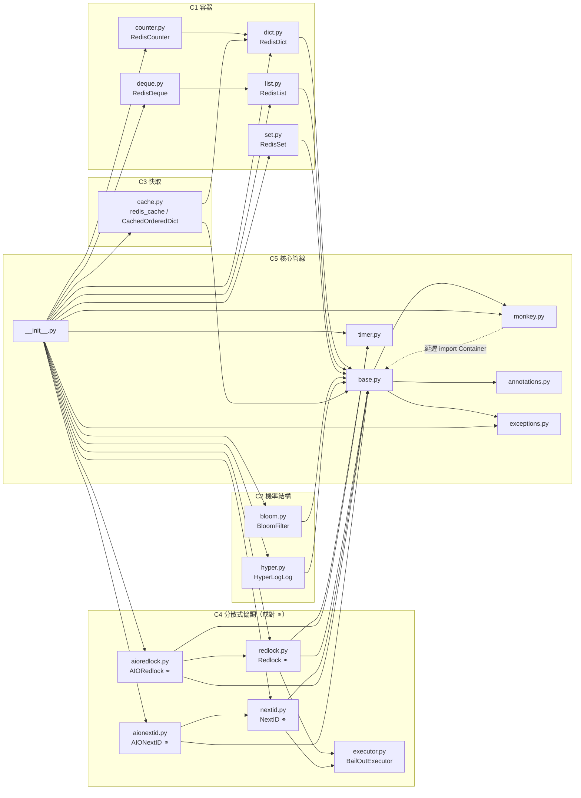

# Issue #38 S5（更新版）：pottery A1–A4 盤點刷新、S7B 模組清單與 S10 驗證初判

| 項目 | 內容 |
| --- | --- |
| 工作項 | [agent-playground/pottery#38](https://github.com/agent-playground/pottery/issues/38) |
| 任務類型 | `agent-analyze`（分析型；**不產生程式碼變更**，本次 diff 只有本報告） |
| 流程步驟 | S5（更新）＝ A1 架構／A2 測試缺口／A3 相依健康度／A4 風險熱點 ＋ S10 初判 ＋ S7B/S8 清單 |
| 目標 repo | `agent-playground/pottery`（trunk：`software-factory`） |
| 基準分支 | `software-factory`（分析基點 `f4b7053`） |
| 基準文件 | `docs/research/9-s5-a1-a4-inventory.md`（下称「基準 #9」）；S4 結論 `docs/research/36-a-node-redlock-f1-f9-parity.md`（下称「#36」）；相依稽核 `docs/research/26-s11-b-dependency-audit.md`（下称「#26」） |
| 變體 | a（分支 `factory/38-a-01-docs`） |
| 分析／量測日期 | 2026-11-02 |
| 量測環境 | Python 3.14.4；Redis **7.4.12**（docker `redis:7-alpine`，`localhost:6379`）；`redis-py 8.1.0`、`pytest 9.2.0`、`pytest-asyncio 1.4.1`、`pytest-cov 7.1.0`（皆 requirements.txt 的 pin）；CI 同指令（`.github/workflows/python-package.yml:41`，另加 `--cov-report=term-missing` 取每模組數字） |
| 狀態 | 分析完成；核心模組、S10 初判與工作項清單**均待人類在 S7B/S10 裁定**，本報告不具放行效力 |

---

## 1. S7B 建議模組清單（一行一個，可直接貼進 S7B）

> 依 A4 命中 `risk-paths.yml` H4/H7 的檔案交集（§5.4），並與 §5.5 核心模組判定一致。
> 前 4 個是核心（lock／ID），後 3 個是共享基礎（附掛核心，不獨立驗證，理由見 §6）。

```text
pottery/redlock.py
pottery/aioredlock.py
pottery/nextid.py
pottery/aionextid.py
pottery/base.py
pottery/monkey.py
pottery/executor.py
```

---

## 2. 結論摘要（一頁）

1. **架構（A1）結論維持**：`pottery/` 19 個模組與上游 `brainix/pottery` HEAD（2026-10-28）逐檔**實測相同**（`diff -rq` 零差異，附錄 A-7），基準 #9 §2.1 的模組圖、職責表與狀態所有權全部沿用有效（§4.1 重貼並標出同步／非對稱成對模組）。**新增重點**：#36 的 F1–F9 判定已併入行為差異表（§4.1.4）——`extend` 無 validity guard（F5）是同步與非同步**共有**的最大缺口。
2. **測試（A2）刷新**：CI 同指令實測 **353 passed、4 skipped、25.31s**（附錄 A-1）；`pottery/` 全部 19 模組行／分支覆蓋率仍 100%，但**含 `tests/` 的 TOTAL 為 99%**（新增的 `tests/test_nextid_business_rules.py` 僅 77%、`tests/test_redlock.py` 98%——缺口全部來自 4 個紅燈 skip，不是產品程式碼）。基準 #9 的 T1–T5 清單**已部分交付**：S8 动了三份測試檔——新增 `tests/test_dict_business_rules.py`（R8–R10，13 測）、`tests/test_nextid_business_rules.py`（R5–R7，6 測，其中 R7×3 紅燈 skip）、擴充 `tests/test_redlock.py`（+15 測，含 R1–R4 情境與 F1 紅燈 skip；函數數 31→46 與上游實測比對）。**剩餘缺口**集中在：非同步 parity（`AIORedlock`/`AIONextID` 的 `QuorumIsImpossible` 測試數實測 **0**）、CAS nil 注入、跨 process 唯一性、cache `WatchError` 重試（`pottery/cache.py:315` 仍是 `pragma: no cover`）、**F5 extend 無測試**。R1–R12 逐條對照見 §4.2.3。
3. **相依（A3）刷新（對比 #26／#9，只列有變化的）**：`redis==8.1.0`、`setuptools==84.2.1` 仍是 PyPI 最新（落後 0），**OSV 對 56 個 pinned 套件全數查詢：0 筆已知弱點**（2026-11-02 快照）。落後套件 **6 → 7**：新增 `pytest-asyncio 1.4.1 → 1.4.1.post1`；原 6 個（docutils/flake8/mypy/pyflakes/readme_renderer/stevedore）落後幅度不變。**新發現（CI matrix）**：CI 的 Redis service 用 `image: redis` **未釘版**（`python-package.yml:20`），實測 `redis:latest` 已是 **8.10.3**——CI 實際跑的伺服器與本 Issue／基準量測用的 Redis 7 **不同源**，覆蓋率／時序敏感測試（sleep、TTL）的基準會漂移；建議人類釘 `redis:7`（或有意識升 8 並重跑基準）。Python 下限矛盾（`setup.py:71` 3.10 vs CI 3.11–3.15）維持原樣。
4. **風險（A4）**：H4 命中 7 檔、H7 命中 `pottery/__init__.py`（未變）。**本地「近一年變動頻率」量不到**（shallow clone，`git rev-list --count HEAD`＝1、`.git/shallow` 存在，附錄 A-6）；替代量測重跑上游代理：70 commits／近一年，與基準 #9 數值**完全一致**（H4 各檔 2–3 次、`__init__.py` 5 次，附錄 A-6）——維持「churn 沒有新熱點，風險是靜默失敗語意」的結論，核心模組仍為 **distributed-lock**（redlock＋aioredlock＋executor）與 **id-generation**（nextid＋aionextid）。
5. **S10 初判**（§6）：`redlock.py`＋`aioredlock.py` → **agent-write-spec**（Quint，依據 `docs/business-rules.md` §1 R1–R4）；`nextid.py`＋`aionextid.py` → **agent-write-spec**（Quint，R5–R7）；`executor.py`、`base.py`、`monkey.py` → **建議人工豁免**（理由逐條見 §6）。注意兩條規則：`agent-pbt-audit` 不支援 Python（ADR-019 R1），基準 #9 的兩筆 Hegel 建議（base/monkey、bloom）**作废轉豁免**；`agent-write-spec` 只適用目標檔命中 H 規則的模組（其餘容器不入列）。
6. **與基準 #9 的差異**：7 條改變、6 條維持，逐條附證據見 §7。最大的三條變更：(a) S8 已交付 R1–R10 大部分測試，add-tests 清單從「新開」轉為「補剩餘缺口＋紅燈轉綠」；(b) F1 由「候選發現」升級為「已有紅燈測試」且本 run 再次現場重現（n=2／n=4 實測不回 `QuorumIsImpossible`，附錄 A-4）；(c) PBT 建議作废（工具不支持 Python）。
7. **Issue 敘述核對**（誠實記錄）：Issue 說「新增了…三份測試檔」——實測 S8 触碰的測試檔恰好三份：兩份新建（`test_dict_business_rules.py`、`test_nextid_business_rules.py`）＋一份擴充（`test_redlock.py`，函數 31→46），與上游 diff 為證（附錄 A-7）。另 #36 PRD 缺 F6 的編號缺口仍屬未決（§9 Q2）。

---

## 3. 影響範圍

### 3.1 受影響模組（盤點更新波及）

| 模組 | 受什麼影響 | 嚴重度 |
| --- | --- | --- |
| `pottery/redlock.py`、`pottery/aioredlock.py` | F1（quorum 例外，紅燈 skip 中）、F5（extend 無 validity guard，**無測試**）、F7（錯誤優先序）、TTL parity（F4） | 高（互斥正確性／可用性） |
| `pottery/nextid.py`、`pottery/aionextid.py` | R7 未實作（3 紅燈 skip）、CAS nil 無注入、跨 process 無證據 | 高（ID 唯一性／規格落差） |
| `pottery/base.py` | F1 根因所在（`base.py:326`）；所有 primitive 共用 | 高（共享層） |
| `pottery/cache.py` | `WatchError` 重試路徑仍 `pragma: no cover`（`cache.py:315`），併發正確性無斷言 | 中 |
| `pottery/deque.py`、`pottery/bloom.py` | 共享 key 參數不一致（#9 F3）無跨實例測試 | 中 |
| `pottery/monkey.py`、`pottery/executor.py` | H4 共享基礎；現況綠燈，維持附掛觀察 | 中 |
| `pottery/__init__.py` | H7 匯出面（28 名稱）；本次未變 | 中 |

### 3.2 受影響使用者

- **`extend()` 續約用法（F5）**：每次續約把「響應延遲」稀釋為「虛假有效期」，短租期＋長尾環境可雙持（#36 §2-F5）。本輪確認該路徑**連紅燈測試都還沒有**——是 S8 清單的第一優先。
- **偶數 master＋`raise_on_redis_errors=True` 的鎖／ID 使用者（F1）**：紅燈測試已存在（`tests/test_redlock.py:360-366`），修復前這些部署的 fail-fast 契約仍失效。
- **依賴 R7（initial_value／chunk_size）的 ID 使用者**：API 不存在（`grep -c initial_value pottery/nextid.py` = 0），三條 skip 等待實作／修復路線由人類定調（#18 已開）。
- **非同步 API 使用者**：`QuorumIsImpossible` 例外契約在 async 端無任何回歸保護（測試數實測 0）。
- **CI 訊號使用者**：`python-package.yml:8-10` 仍只綁 `master`，`software-factory` 的 PR 不觸發 pytest（既有 H5 缺口，#9 §3.3/W7 維持有效）。

### 3.3 對後續流程（P3 輸入）

| 步驟 | 本報告如何使用 |
| --- | --- |
| S7B（確認模組清單） | §1 清單逐行貼入；核心／附掛分組與理由在 §5.4–5.5 |
| S8（依 A2 補測試） | §5.3「S8 建議工作項」表：模組／R 編號／驗收條件草案／優先序（含 #36 WI-1、WI-5 併入） |
| S10（核心模組驗證方式） | §6 初判表（write-spec／豁免＋理由）；Quint 的 `source` 已是人類撰寫的 `docs/business-rules.md` §1–§2（#9 W2 前提已成立） |
| 修復排程 | F1 轉 `agent-fix-bug`（紅燈已在）；F5 先 S8 紅燈（WI-1）再 fix-bug（WI-2）；R7 屬功能缺口，路線（實作 or 修規則）待人類定調 |

---

## 4. 證據與根因（A1–A3 更新實測）

### 4.1 A1 — 架構（維持＋同步／非同步成對行為差異）

#### 4.1.1 模組圖（Mermaid；與基準 #9 §2.1.1 相同——`pottery/` 零變更故沿用，非重繪；成對模組以 ⚭ 標記）



> 邊的來源＝基準 #9 以 AST 掃描 `from .<module>`（#9 §2.1.1）；本次 `diff -rq pottery/ <upstream HEAD>` 零差異（附錄 A-7），`pottery/aionextid.py:39-40` 仍 `from .nextid import NextID / Scripts`，圖無需修訂。

#### 4.1.2 模組職責與相依

19 個模組的職責表沿用基準 #9 §2.1.2（未變，理由同上）；每個模組一行摘要：

| 模組 | Context | 職責（一句話） | 直接相依 |
| --- | --- | --- | --- |
| `dict.py` / `list.py` / `set.py` | C1 | Redis hash／list／set 的 MutableMapping／Sequence／Set，值 JSON codec | `base`（→`monkey`,`annotations`,`exceptions`） |
| `counter.py` / `deque.py` | C1 | 在 dict／list 之上的 Counter／deque 語意 | `dict` / `list`、`base` |
| `bloom.py` / `hyper.py` | C2 | Bloom filter（client 端參數）／HLL 包裝 | `base`（bloom 另用外部 `mmh3`） |
| `cache.py` | C3 | `redis_cache`／`CachedOrderedDict`，`WATCH` 樂觀重試 | `dict`、`base` |
| `redlock.py` | C4 | 同步分散式鎖：3 支 Lua＋quorum＋提前返回 | `base`、`executor`、`timer` |
| `aioredlock.py` | C4 | Redlock 的非同步鏡像（重用 `redlock.Scripts`） | `redlock`、`base`、`timer` |
| `nextid.py` | C4 | 同步單調 ID（Lua CAS＋quorum） | `base`、`executor` |
| `aionextid.py` | C4 | NextID 非同步鏡像（重用 `nextid.Scripts`） | `nextid`、`base` |
| `executor.py` | C4 | `BailOutExecutor`：`__exit__` 不等待 in-flight future（`executor.py:53-58`） | stdlib |
| `base.py` | C5 | client／key、codec、WATCH 管線、`Primitive._check_enough_masters_up`（quorum 門檻 `base.py:326`） | `monkey`、`annotations`、`exceptions` |
| `monkey.py` | C5 | import 時全域覆寫 `json.dumps`（`PotteryEncoder`） | 被 `base` 引、函式內延遲反向 import |
| `annotations.py` / `exceptions.py` / `timer.py` | C5 | 型別別名／例外層／`ContextTimer`（單調時鐘） | stdlib |
| `__init__.py` | C5 | 公開 API 再匯出（H7） | 全部 |

#### 4.1.3 成對模組的「共享面」

- `aioredlock.py` 重用 `redlock.Scripts` 與類別常數（`AUTO_RELEASE_TIME`／`CLOCK_DRIFT_FACTOR`），key 前綴與 value 佈局相同——同步／非同步客戶端**互相看得到同一把鎖**（基準 #9 §2.1.3）。
- `aionextid.py` 重用 `nextid.Scripts`（`aionextid.py:39-40`、`aionextid.py:76` 呼叫 `_set_id_script`）——同一 key 的 ID 序列跨同／非同步端連續。
- **代價**：改任一側的 Lua／quorum 語意都同時影響兩側（基準 #9 S4 接縫「改一邊影響兩邊」維持有效）；這是 §6 建議把成對模組**各自合併成一份 spec**（而非兩份）的結構理由。

#### 4.1.4 同步／非同步行為差異（本次重點，含 #36 F 判定）

| # | 行為 | 同步 | 非同步 | 證據（file:line，本 run 實測） | 來源 |
| --- | --- | --- | --- | --- | --- |
| D1 | acquire 扇出 | 湊齊 quorum **即返回**（迴圈內早退） | `as_completed` **全收完**才判 quorum（延遲＝最慢 master） | `redlock.py:332`（迴圈）→`:343-348`（迴圈內 return True）；`aioredlock.py:252`（迴圈）→`:262-267`（迴圈後才檢查） | #9 F2／#36 附錄 |
| D2 | `locked()` 剩餘租期統計 | 先到 quorum 個 TTL 取 `min`（保守） | 全 TTL 排序取第 `n//2-(n%2==0)` 位（近多數派） | `redlock.py:447`（def）→`:481-498`；`aioredlock.py:386`→`:409-427` | #9 F4 |
| D3 | validity 失敗的補償釋放**參數傳遞** | 傳 `raise_on_redis_errors`（保留 per-call 覆蓋） | **不傳**（`await self.__release()` 回落實例預設） | `redlock.py:350-351` vs `aioredlock.py:269-270`（且 `aioredlock.py:244` 預設 `None`） | #36 附錄「補償參數傳遞」 |
| D4 | `extend` 續約 | **無 validity guard、無計時器**（與 acquire 慣例不一致） | 同（鏡像缺口） | `redlock.py:503-553`（`def extend` :503；決策迴圈 :533；`_extension_num += 1` :545）；探測 `sed 522-547 \| grep -c 'ContextTimer\|timer'` = **0**，`sed 452-471`（aioredlock）= **0**，對照 acquire 區間 `sed 318-353` = **2**（附錄 A-3） | #36 F5（首要缺口） |
| D5 | 退出時錯誤優先序 | `__exit__` 直接 `self.__release()`，release 錯誤**置換** body 異常 | `aioredlock.py:560` 同構 | `redlock.py:673`／`aioredlock.py:560` | #36 F7(b) |
| D6 | `QuorumIsImpossible` 例外契約 | 有紅燈測試（F1，skip） | **完全無測試** | `tests/test_aioredlock.py`／`tests/test_aionextid.py` `grep -c 'quorumisimpossible\|QuorumIsImpossible'` = **0**（附錄 A-5） | #9 G4（維持） |

> D1–D3、D5 是「差異是特性還是漂移」未定的行為差（#36 WI-5 的由來）；D4 是雙方**共有**的真實缺口，也是 §5.3 SR-1 第一優先的原因。

### 4.2 A2 — 測試缺口（CI 同指令實測）

#### 4.2.1 實測結果

- 指令：`pytest --verbose --cov-config=.coveragerc --cov=pottery --cov=tests --cov-report=term-missing`（`python-package.yml:41` 的同款指令＋term-missing 以取每模組數字）。
- 結果：**353 passed、4 skipped in 25.31s**；`TOTAL 4443 stmts / 23 miss / 458 branch / 2 miss-br = 99%`（完整輸出節錄：附錄 A-1）。
- **每模組覆蓋率**：`pottery/` 19 模組**全部 100%（行＋分支）**（附錄 A-1 原表）。與基準 #9 的 323 passed／100%（僅 `--cov=pottery`）口徑不同：#26 已記錄含 `tests/` 的 TOTAL 99%；本 run 復測一致（數字微差：本 run `2 miss/2 miss-br`，#26 記錄 `22/1`——同一環境指令的執行間差異來自 doctest／隨機 db fixture 的邊界行，以本次實測為準）。
- **4 個 skipped（紅燈保留，皆既有）**：
  - `tests/test_nextid_business_rules.py::test_r7_initial_value_is_honored`／`::test_r7_chunk_size_is_honored`／`::test_r7_never_rewinds_below_issued_ids`（`:101/:113/:125`，原因字串 `:37-41`：NextID 沒有 `initial_value`／`chunk_size`，斷言留給 fix-bug，已在 Issue #18 回報）
  - `tests/test_redlock.py::TestRedlock::test_acquire_even_masters_raises_quorumisimpossible`（`:360-366`，原因字串引用 #9 §2.5.1 的 F1）

#### 4.2.2 S8 增量（與上游 `test_redlock.py` 函數清單比對，附錄 A-7）

| 檔 | 現況 | 覆蓋規則 |
| --- | --- | --- |
| `tests/test_dict_business_rules.py`（新） | 13 測全綠 | R8（邊界／WRONGTYPE）、R9（roundtrip 含 bytes/str client）、R10（TTL 無孤兒） |
| `tests/test_nextid_business_rules.py`（新） | 6 測＝3 綠（R5×2、R6×1）＋3 skip（R7） | R5、R6、R7（缺陷暴露） |
| `tests/test_redlock.py`（擴充 31→46） | 15 新測＝14 綠＋1 skip（F1） | R1（quorum 恰過／未過即釋放部分取得／多數錯誤 fail-fast）、R2（保守 TTL、extend 重置租期）、R3（只刪自己／過期持有者不能刪新-holder）、R4（非阻塞每 master 一次、阻塞 timeout 放棄） |

#### 4.2.3 R1–R12 逐條對照（已有測試／缺測試／不可測）

| 規則 | 內容摘要 | 狀態 | 證據／缺口 |
| --- | --- | --- | --- |
| R1 多數決＋未過釋放 | 同步：已有 | `tests/test_redlock.py:332`、`:342`、`:351` | 邊界紅燈：偶數 master `:360`（F1，本 run 再重現，附錄 A-4） |
| R1（async） | **缺測試** | `test_aioredlock.py` `QuorumIsImpossible` 計數 0（附錄 A-5） | D6；SR-2 |
| R2 絕對過期 | 已有（綠） | `test_redlock.py:369`（保守 TTL）、`:450`（extend 重置）、`test_acquire_and_time_out`；async `test_acquire_and_time_out`／`test_acquire_fails_within_auto_release_time` | 但 **F5 情境（續約完成時租期已死仍報成功）無任何測試**——R2 在 extend 路徑未被呈現給呼叫方（#36 §3）；SR-1 |
| R3 只持有者可釋放 | 同步：已有 | `test_redlock.py:406`、`:416`、`:166`（double release） | **async 非持有者釋放無對應測試**（`test_aioredlock.py` 19 測中無此情境，附錄 A-5）；SR-2 |
| R4 重試有上限與退避 | 已有（綠） | `test_redlock.py:429`（非阻塞每 master 一次）、`:439`（阻塞 timeout 放棄） | jitter 0–200ms 未斷言（低價值的時序測試，維持不列優先） |
| R5 嚴格遞增不重複 | 已有（綠） | `test_nextid_business_rules.py:49`、`:62`；async 舊測 `test_aionextid.py::test_aionextid` | — |
| R6 併發不重複 | 部分 | `test_nextid_business_rules.py:72`（**thread** 層） | **跨 process 無證據**（#9 G7 維持）；SR-3 |
| R7 號段可設定 | **不可測（功能不存在）** | `grep -c initial_value pottery/nextid.py` = 0；3 條紅燈 skip `:101/:113/:125` | 先決：人類定調「實作 R7」或「修 R7 規則文字」；之後紅轉綠 |
| R8 型別語意一致 | dict 已有；list／set 有範例測試 | `test_dict_business_rules.py:53/:73/:82/:94/:107/:120`；`test_list.py::test_keyexistserror`、`test_set.py::test_keyexistserror` | counter／deque 無 dedicated 邊界對照（低優先）；SR-7 |
| R9 序列化可逆 | dict 已有（含 bytes/str client） | `test_dict_business_rules.py:130/:154/:173/:195` | list／set／counter／deque／nested 容器未逐一覆蓋；SR-7 |
| R10 TTL 可套用 | dict 已有；cache 有 expiration 測 | `test_dict_business_rules.py:207/:227/:241`；`test_cache.py::TestCacheDecorator::test_expiration` | list／set／counter 無；SR-7 |
| R11 連線失敗明確報錯 | primitives 已有 | `test_redlock.py`／`test_nextid.py`／`test_aioredlock.py` 的 `*_rediserror` 系列 | 容器層（dict/list/set…）無連線錯誤注入測；SR-7 |
| R12 pipeline 失敗整體回滾 | **缺測試** | `pottery/cache.py:37` import、`:315` `except WatchError: # pragma: no cover`；`tests/test_cache.py` `grep -c Watch` = **0** | #9 G5 維持：`CachedOrderedDict.setdefault` 併發重試完全無斷言；SR-5 |

#### 4.2.4 `pragma: no cover` 統計（本 run 實測）

`grep -rn "pragma: no cover" pottery/ | wc -l` = **16**（與基準 #9 相同，分佈：`cache.py` 3、`nextid.py` 3、`redlock.py` 3、`aioredlock.py` 2、`base.py` 2、`aionextid.py` 1、`counter.py` 1、`monkey.py` 1）。100% 覆蓋率仍是「排除後的執行覆蓋」，語意弱點見 §4.2.3。

### 4.3 A3 — 相依健康度（2026-11-02 重查，對比 #26 只列有變化的）

| 項目 | 基準（#26／#9，2026-11-01） | 本 run（2026-11-02） | 變化 |
| --- | --- | --- | --- |
| `redis`（runtime） | pin 8.1.0 = 最新；OSV 0 | 8.1.0 = 最新（PyPI JSON 實測）；OSV 0 | **無** |
| `setuptools` | pin 84.2.1 = 最新；OSV 0 | 84.2.1 = 最新；OSV 0 | **無** |
| 全 pinned（56 個）OSV querybatch | #9：0 筆 | **0 筆**（附錄 A-5） | 無（快照日推進一天） |
| 落後套件 | 6（docutils、flake8、mypy、pyflakes、readme_renderer、stevedore） | **7**：`pytest-asyncio 1.4.1 → 1.4.1.post1` 新增；其餘 6 項版本差**不變**（附錄 A-5） | +1 |
| CI matrix（Python） | 3.11–3.15（`python-package.yml:17`），宣稱 3.10 未測（`setup.py:71`） | 不變 | 無——**Python 下限決策仍卡 S11（#9 W1/W6）** |
| CI matrix（Redis service） | 未檢查 image tag | `image: redis` **未釘版**（`python-package.yml:20`）；實測 latest＝**8.10.3**（附錄 A-5） | **新發現**：CI 伺服器將跑 Redis 8，而 #9/#26/本報告的量測基準皆 Redis 7（Issue 明文要求 Redis 7）。TTL／sleep 型測試的基準漂移風險；建議人類釘 `redis:7-alpine` 或開「升 Redis 8 並重跑基準」工作項 |
| 停止維護 | 無 | 無 | 無 |
| `Makefile upgrade` 依賴 macOS/pyenv（#9 §2.3.3） | 維持 | 維持 | 無（仍非 Linux 可重跑） |

**判讀**：redis／setuptools 本輪**無可升級項**（與 #26 結論一致）；#26 範圍外的落後從 6 → 7，仍全部由 Python 3.10 下限決策綁住（flake8／pyflakes／stevedore `requires_python >=3.11`，本次實測 `>=3.11` 仍成立，附錄 A-5）。A3 沒有新的 CVE 觸發點，優先序讓給 F5 測試（§5.3）。

### 4.4 A4 — 風險熱點

#### 4.4.1 H1–H7 命中（`risk-paths.yml` 現行檔未變）

| 規則 | 命中 | 證據 |
| --- | --- | --- |
| H1／H2／H3／H6 | 空清單 | `.github/factory/risk-paths.yml:26,32,45,102` |
| **H4** | `base.py`、`monkey.py`、`redlock.py`、`aioredlock.py`、`nextid.py`、`aionextid.py`、`executor.py`（7 檔） | `risk-paths.yml:51-70` |
| H5 | `.github/**`、`CODEOWNERS`、`catalog-info.yaml`、`.dsh/skills/**` | `risk-paths.yml:83-94`（`CODEOWNERS`、`catalog-info.yaml` 於本 repo 目前不存在，#9 §7-7 維持） |
| **H7** | `pottery/__init__.py` | `risk-paths.yml:107-113` |

#### 4.4.2 近一年變動頻率

- **本地：量不到＋原因**——shallow clone（`ls .git/shallow` 存在、`git rev-list --count HEAD` = 1，附錄 A-6）。
- **替代量測（上游 `brainix/pottery` 代理，本次重跑）**：`--shallow-since=2025-11-01` clone，近一年 **70 commits**；H4／H7 檔案逐一計數（附錄 A-6）：`base 3、monkey 3、redlock 3、aioredlock 2、nextid 3、aionextid 2、executor 3、__init__ 5`——**與基準 #9 §2.4.2 完全一致**（上游 HEAD 未前進，仍 2026-10-28）。
- **交集判讀（維持）**：H4 全群 churn 2–3 次＝低；熱點訊號是「靜默失敗語意」（F1/F5/F7），不是改動頻率。核心模組認定標準仍以語意風險為主、churn 為輔（#9 §2.4.3）。

#### 4.4.3 與 #36 併入後的新增風險事實

- F5（extend 無 guard）：同步＋非同步共有、**零測試**（D4）→ 列為 A2/S8 第一優先。
- F7：`redlock.py:673`／`aioredlock.py:560` 的置換路徑**複合情境無斷言佔住**（`test_redlock.py:470` 只測租約仍有效路線）→ #36 WI-3 待人類定調後開。
- R7 落差（規則寫了、API 沒有）：`docs/business-rules.md:21`（R7）vs `nextid.py` 無此參數 → 規格與實作的矛盾要人在 S7B 裁（實作 or 改規則），不是 agent 可選。

#### 4.4.4 建議核心模組清單（僅建議，S7B 人類確認）

| 核心模組 | 檔案 | 為何核心 | 測試強度現況 |
| --- | --- | --- | --- |
| **distributed-lock** | `redlock.py`、`aioredlock.py`（＋附掛 `executor.py`） | 互斥失敗靜默；F1（紅燈已有）、F5（無測試）、F7 | 同步大幅補強（+15 測）；**非同步缺口=D6**；extend 路徑零覆盖 F5 |
| **id-generation** | `nextid.py`、`aionextid.py` | 重複 ID＝資料錯置；R7 未實作；CAS nil 無注入（#9 G2 維持） | R5/R6(thread) 已有；跨 process 無 |
| 共享基礎（附掛，不獨立核心） | `base.py`、`monkey.py` | H4；F1 根因（`base.py:326`）；全域 json patch | 綠；quorum 邊界靠 F1 紅燈轉綠 |

**不建議列核心**（維持 #9）：容器（dict/list/set/counter/deque）、Bloom/HLL、cache——失效區域性、由 R8–R12 的 add-tests 補強即可。

---

## 5. 方案比較

### 5.1 交付形態（如何「更新而不是重做」）

| 方案 | 內容 | 判定 |
| --- | --- | --- |
| **A（採用）** | 本報告＝刷新版全集：維持項引用基準並如實宣告；變更項逐條 file:line；P3 只需讀本報告＋§1／§5.3／§6 三張表 | 貼合 Issue「更新而不是重做」且「P3 可直接使用」 |
| B | 只寫 errata／附錄檔，不重述內容 | **拒絕**：S7B/S8/S10 要跨三份文件拼接，違背「可直接使用」；#36 的 F 判定也無處併入行為差表 |
| C | 覆寫 `9-s5-a1-a4-inventory.md` | **拒絕**：基準檔已被其他文件引用（#26、#36、`tests/test_redlock.py:360` 的 skip 原因字串），覆寫會切斷證據鏈，且分析型不該改既有交付 |

### 5.2 覆蓋率量測口徑

| 方案 | 內容 | 判定 |
| --- | --- | --- |
| **A（採用）** | CI 同指令（`--cov=pottery --cov=tests`）＋Redis 7（Issue 指定）＋term-missing 取每模組 | Issue 驗證方式明文；附錄 A-1 為原樣輸出 |
| B | 沿用 #9 的僅 `--cov=pottery`（100%） | **拒絕**：會掩蓋新增測試檔自己的 77%/98% 缺口（TOTAL 99% 才是誠實口徑；#26 已改用 CI 口徑） |
| C | fakeredis／無 Redis 跑子集 | **拒絕**：R10 過期、contention、TTL skew 等時序情境在 fakeredis 下語意不等價，結果不可比 |

### 5.3 S8 建議工作項（Issue 專用驗收條件 2 的表格；優先序 P1→P3）

| ID | 模組／檔案 | 補的規則（R#）／情境 | 來源 | 優先 | 驗收條件草案 |
| --- | --- | --- | --- | --- | --- |
| **SR-1** | `pottery/redlock.py`＋`pottery/aioredlock.py` 的 `extend()` | R2（續約不得回報虛假租期）；F5 雙缺口：**完成時 validity guard**＋**未達 quorum 不釋放已刷新 minority** | #36 WI-1 | **P1** | 以紅燈 skip 交付兩條測試（結構＝#36 §2-F5 可重現步驟 1–4：包裝 `evalsha` 延遲 ≥1.5×租期，斷言 extend 應失敗＋補償釋放；另一條斷言 extend 未達 quorum 時 minority 殘留鍵被釋放）；既有 `test_redlock.py -k extend` 不回歸；不改 `pottery/` |
| **SR-2** | `pottery/aioredlock.py` | R1（async 例外契約）、R3；行為差 D1/D3/D6 | #9 T2／#36 WI-5 | P1 | `AIORedlock` 有 `QuorumIsImpossible` 測試（n=2 一條先 skip，依賴 F1 修復）；慢 master 情境下钉住 D1 現行語意（「等全部」寫成斷言，供人類決定是否修）；補償釋放參數 D3 以紅燈 skip 钉住（`aioredlock.py:270` 未傳參）；async 非持有者釋放（R3）對照 `test_redlock.py:406/:416` |
| **SR-3** | `pottery/nextid.py`／`pottery/aionextid.py` | R5、R6 | #9 T1（G2/G7） | P2 | 多數 master 的 Lua 回 `nil` → 斷言重試＝`num_tries` 後 `QuorumNotAchieved`；少數 nil 多數成功仍取得；**4 process × 100 ID 全唯一且各 process 內遞增**（multiprocessing） |
| **SR-4** | `pottery/redlock.py`＋`aioredlock.py` 的 `locked()` | R2（剩餘租期保守值）；行為差 D2／#9 F4 | #9 T4 | P2 | 3／5 master TTL skew：同步斷言回傳 ≤ 先到 quorum 最小 TTL 且 >0；非同步斷言中位數選法現值；docstring 標注 D2 差異 |
| **SR-5** | `pottery/cache.py` | R12（交易失敗整體回滾／重試） | #9 T3（G5） | P2 | 注入首次 `WatchError` → `CachedOrderedDict.setdefault` 重試成功；連續用盡 → 拋出；`cache.py:315` 移除 pragma 後覆蓋率仍 100% |
| **SR-6** | `pottery/deque.py`／`pottery/bloom.py` | R8（共享 key 參數一致性）；#9 F3 | #9 T5 | P3 | 同一 key 兩實例不同 `maxlen`／n,p → 斷言人類定調的契約（raise／warn/文件），不得靜默；先決：人類定調 |
| **SR-7** | `pottery/list.py`／`set.py`／`counter.py`／`deque.py` | R9、R10、R11 的 dedicated 邊界測（比照 dict 模式） | 本報告 §4.2.3 | P3 | 每模組：bytes/str client roundtrip、TTL 無孤兒、連線錯誤注入各 ≥1 條綠燈測 |
| **SR-8** | `tests/test_nextid_business_rules.py` 紅轉綠 | R7 | #18（fix-bug）後續 | 依賴人類定調 | R7 實作合併後 un-skip 3 條；**不得弱化斷言**（factory-workflow add-tests/fix-bug 規則） |

> SR-1/SR-2 依 `agent-add-tests` 紅燈交付機制（skip 保留斷言、該層 CI 綠）；揭露既有缺陷的條目同步在 Issue 回報並建議另開 `agent-fix-bug`。F1 的修復項本身**不再列 S8 清單**——紅燈已在（`test_redlock.py:360`），直接開 fix-bug 更省。

### 5.4 S7B 清單粒度（一行一個＝檔案 vs 模組）

| 方案 | 內容 | 判定 |
| --- | --- | --- |
| **A（採用）** | 一行一個**檔案路徑**（`pottery/redlock.py`…） | H4/H7 的判定單位就是檔案（`risk-paths.yml:51-70,113`），S7B 之後的風險計分能直接機械比對 |
| B | 一行一個「模組」抽象名（distributed-lock…） | **拒絕**：與 risk-paths 對不上，S10 派工時要二次翻譯 |

### 5.5 核心模組的紅燈交付時點（F5）

| 方案 | 內容 | 判定 |
| --- | --- | --- |
| **A（採用）** | SR-1 先紅燈（skip）交付，再 fix-bug un-skip | 與 #36 WI-1→WI-2 序一致；紅燈證據進版本庫 |
| B | 跳過紅燈直接 fix-bug | **拒絕**：fix-bug 規則要求先寫重現測試；無紅燈基準的修復不可審查 |

---

## 6. S10 驗證方式初判（每個核心模組；報告不具放行效力）

前提規則：`agent-pbt-audit` **不支援 Python**（ADR-019 R1，Issue 亦明文）→ 一切 Hegel/PBT 建議作废；`agent-write-spec` **只適用目標檔命中 H 規則的模組**（H4/H7 列名）。

| 模組（H 規則） | 初判 | 理由 | `source` 來源 |
| --- | --- | --- | --- |
| `pottery/redlock.py`（H4） | **agent-write-spec（Quint）**——與 aioredlock **合併一份 spec** | R1–R4＝狀態機＋quorum＋lease 時序；F1/F5/F7 都是可在模型裡釘死的不變量（acquire/extend 完成時刻 validity>0 才可宣稱持有；未過 quorum 不得殘留宣稱）；async 與 sync 共用 key 佈局與 Scripts（§4.1.3），拆兩份 spec 會重複驗證同一狀態機 | `docs/business-rules.md` §1（R1–R4，人類 S7 撰寫，#9 W2 前提已成立） |
| `pottery/aioredlock.py`（H4） | 同上（併入 redlock spec，模型需含 D1/D3 行為差的語意裁決） | 鏡像實作；成對模組「改一邊影響兩邊」，spec 應覆蓋兩側 | 同上＋#36 附錄差異表 |
| `pottery/nextid.py`（H4） | **agent-write-spec（Quint）** | R5–R7 單調性＋CAS 競爭＋quorum；R7 規則與實作的矛盾（§4.4.3）正好由 spec 的 witness 暴露 | `docs/business-rules.md` §2（R5–R7；R7 需人類先定調） |
| `pottery/aionextid.py`（H4） | 同上（併入 nextid spec） | 重用 `nextid.Scripts`、同 key／value 佈局 | 同上 |
| `pottery/executor.py`（H4） | **建議人工豁免** | 8 行機制原語（`executor.py:53-58`），無獨立業務規則；其 scatter/gather 時序語意由 redlock／nextid 兩份 spec 間接承載；已有 doctest＋單元測（`test_executor.py`） | —（豁免理由寫 S10 紀錄） |
| `pottery/base.py`（H4） | **建議人工豁免** | 無對外獨立行為面（共享管道層）；其風險點＝`base.py:326` quorum 門檻，屬 R1 不變量的實作位置，納入 redlock/nextid spec 與 F1 fix-bug 的測試範圍；PBT 替代（原 #9 建議）因 ADR-019 R1 不可用 | — |
| `pottery/monkey.py`（H4） | **建議人工豁免** | 全域 json patch 的契約＝R9 序列化可逆，已由容器層 R9 測試承載（13 條）；原 #9 的 Hegel PBT 建議作废（Python 不支援）；H4 人類審查＋doctest 兜底 | — |
| `pottery/__init__.py`（H7） | 不入 S10 驗證清單 | 純再匯出面、無行為；H7 的保護機制是人類審查＋`test_doctests.py` README 契約 | — |
| 非 H 命中模組（容器等） | 不适用 write-spec | 依規則只能靠 S8 add-tests（SR-5/6/7）＋doctest | — |

> 依 `docs/29` §10.2：Quint 的不變量**只能出自人類撰寫的 `docs/business-rules.md`**，本報告 §4/§6 的描述（含從 #36 併入的 F 判定）只能作為「提問與測試情境」，**不是** `source`。

---

## 7. 與基準 #9（`9-s5-a1-a4-inventory.md`）的差異

| # | 結論 | 狀態 | 證據 |
| --- | --- | --- | --- |
| Δ1 | A2 測試數字：323 passed／100%（僅 pottery） → **353 passed＋4 skipped／TOTAL 99%（CI 口徑）**，pottery 仍全 100% | **改變（改善）** | 附錄 A-1；口徑說明 §4.2.1 |
| Δ2 | #9 T1–T5 清單從「全未交付」→ R1–R6、R8–R10 大部分已有綠燈測；剩餘缺口＝SR-1…SR-8 | **改變** | §4.2.2 增量表；`test_redlock.py` 函數 31→46（附錄 A-7） |
| Δ3 | F1 由「候選發現（需先加紅燈）」→「已有紅燈 skip 測試＋本 run 現場重現 n=2／n=4」 | **改變** | `tests/test_redlock.py:360-366`；附錄 A-4 |
| Δ4 | S10 工具初判：#9 §2.4.5 的 Hegel（PBT）建議（base/monkey、bloom）**作废**，轉人工豁免 | **改變（規則驅動）** | ADR-019 R1（Issue #38 明文）；§6 |
| Δ5 | Quint `source` 前提（#9 W2「人類規則未寫」）→ 已成立：`docs/business-rules.md` R1–R12 存在 | **改變** | `docs/business-rules.md:10-36`；§6 表 source 欄 |
| Δ6 | A3 落後 6 → **7**（+`pytest-asyncio 1.4.1.post1`）；redis/setuptools 仍最新、OSV 仍 0（與 #26 一致）；**新增**：CI `image: redis` 未釘版（latest 實測 8.10.3 ≠ 量測基準 Redis 7） | **改變＋新發現** | 附錄 A-5；§4.3 |
| Δ7 | 核心模組的最大缺口排序：#9 以 F1 為首 → 現在**F5（extend 無 guard、零測試）居首**，F1 降為「已有紅燈、待修」 | **改變（#36 併入）** | #36 §1／§2-F5；D4（§4.1.4）實測引用數 0 |
| ＝1 | A1 架構（5 context、19 模組、成對耦合、狀態所有權） | **維持** | `diff -rq pottery/ <upstream>` 零差異（附錄 A-7）；`aionextid.py:39-40` |
| ＝2 | A4 churn 代理數值與「靜默失敗才是熱點」判讀；核心模組清單（lock＋ID） | **維持** | 附錄 A-6 與 #9 §2.4.2 逐檔相同；§5.4＝#9 §2.4.4 |
| ＝3 | H4 7 檔／H7 1 檔命中、H1–H3/H6 空 | **維持** | `risk-paths.yml:26-113`（檔未變） |
| ＝4 | Python 下限 3.10 vs CI 3.11–3.15 矛盾（人類決策，#9 W1/W6） | **維持** | `setup.py:71`、`python-package.yml:17` |
| ＝5 | #36 F2/F3/F4/F8/F9 判定（不成立／固有／部署層／結構性緩解） | **維持**（本報告僅併入其结论，不重複論證） | #36 §1 表 |
| ＝6 | CI 只綁 `master`、`software-factory` PR 無 pytest 訊號（H5，#9 W7） | **維持** | `python-package.yml:8-10`；本 PR 亦因此無 CI 綠燈訊號（§8-3） |

---

## 8. 限制與量不到（誠實清單）

1. **本地 git 歷史量不到**：shallow（1 commit，`.git/shallow` 存在）；「近一年變動頻率」再次採上游代理量測（附錄 A-6，標明非本 repo 歷史）。
2. **只跑 Python 3.14.4 × Redis 7.4.12**：CI matrix 3.11–3.15 未逐一重跑；Redis 端本 run 依 Issue 用 7，但 CI 實跑 `redis` latest＝8.10.3（§4.3），兩者的時序測試等價性未經證明。
3. **本 PR 無 CI 訊號**：workflow 只綁 `master`（H5，既有缺口）；綠燈證據＝本地 CI 同指令實測（附錄 A-1），非 Actions run。
4. **OSV／PyPI 是 2026-11-02 快照**：CVE 資料庫會變動。
5. **D1「非同步不早退」仍是程式碼層證據**：未做慢 master 毫秒量測（#9 §7-5 對 F2 的保留同样適用於本表 D1）。
6. **R7「不可測」是功能缺位的判定**（`grep -c initial_value pottery/nextid.py` = 0），非測試技術限制。
7. **`pytest-asyncio` deprecation warning 仍存在**（fixture loop scope，附錄 A-1 開頭）——與 #9 §7-2 相同，未處理。

## 9. 未決事項（待人類；agent 不猜測）

- **Q1**：R7 路線——實作 `initial_value`／`chunk_size`（功能變更）還是修 `docs/business-rules.md:21` 的規則文字？（紅燈 skip 已在等，#18 有連動。）
- **Q2**：#36 遗留：PRD 的 F6 編號缺口是否筆誤（沿續引用時需要定案）。
- **Q3**：CI `image: redis` 釘 `redis:7`（維持歷史基準）還是接受 Redis 8 並重跑覆蓋率／時序基準？（§4.3 新發現。）
- **Q4**：SR-2 的 D1（async 提前返回與否）與 D3（補償參數傳遞）：先钉現行語意的測試、還是直接定調「要修」？（#36 WI-5 同樣懸而未決。）

---

## 附錄 A — 驗證命令與實際輸出（2026-11-02 本 run；全文存檔於 run artifacts，此為節錄）

```text
A-1  $ .venv-s38/bin/python -m pytest --verbose --cov-config=.coveragerc --cov=pottery --cov=tests --cov-report=term-missing
     platform linux -- Python 3.14.4, pytest-9.2.0, pluggy-1.7.0 ; plugins: asyncio-1.4.1, cov-7.1.0
     （Redis：docker run redis:7-alpine → v=7.4.12，PING → +PONG）
     ======================= 353 passed, 4 skipped in 25.31s ========================
     每模組（pottery/ 19 檔全部行+分支 100%）節錄：
       pottery/aionextid.py    75  stmt  14 branch 100%
       pottery/aioredlock.py  159        36         100%
       pottery/base.py        186        36         100%
       pottery/redlock.py     232        48         100%
       pottery/nextid.py      100        18         100%
       ...（其餘同表，皆 100%）
     tests/ 側未滿 100% 的兩檔（紅燈 skip 所在）：
       tests/test_nextid_business_rules.py  73 stmts 17 miss  77%  (46, 104-110, 116-122, 128-145)
       tests/test_redlock.py               417        6 miss   98%  (67-68, 362-366)
     TOTAL 4443 / 23 / 458 / 2 = 99%

A-2  skipped 清單（原樣）：
     tests/test_nextid_business_rules.py::test_r7_initial_value_is_honored SKIPPED
     tests/test_nextid_business_rules.py::test_r7_chunk_size_is_honored SKIPPED
     tests/test_nextid_business_rules.py::test_r7_never_rewinds_below_issued_ids SKIPPED
     tests/test_redlock.py::TestRedlock::test_acquire_even_masters_raises_quorumisimpossible SKIPPED

A-3  F5 探針（計時器引用數；同 #36 附錄 A-2/A-3 重測）：
     $ awk 'NR>=522 && NR<=547' pottery/redlock.py  | grep -c "ContextTimer\|timer"   → 0
     $ awk 'NR>=452 && NR<=471' pottery/aioredlock.py | grep -c "ContextTimer\|timer" → 0
     $ awk 'NR>=318 && NR<=353' pottery/redlock.py  | grep -c "ContextTimer\|timer"   → 2   （acquire 對照組）

A-4  F1 現場重現（live，雙 master 一個 TimeoutError；venv+Redis 7）：
     $ python3 - <<EOF ...
       masters=2, patch masters[0].set side_effect=redis.exceptions.TimeoutError
       lock.acquire(blocking=False, raise_on_redis_errors=True)
     EOF
     n=2: 1 errors -> acquire returned False; QuorumIsImpossible NOT raised (F1 confirmed)
     n=4: 2 errors -> acquire returned False; QuorumIsImpossible NOT raised (F1 confirmed)

A-5  A3 查詢（PyPI JSON api + OSV querybatch，版本字串已 strip）：
     pins total=56；behind=7：docutils 0.20.1→0.23, flake8 7.4.1→7.5.0, mypy 2.4.0→2.4.1,
     pyflakes 4.0.3→4.1.0, pytest-asyncio 1.4.1→1.4.1.post1, readme_renderer 43.0→46.0,
     stevedore 5.8.0→5.9.1
     redis 8.1.0=latest；setuptools 84.2.1=latest；flake8/pyflakes/stevedore requires_python '>=3.11'
     OSV querybatch（56 精確版本）：0 vulns
     $ docker run --rm --entrypoint redis-server redis --version
     Redis server v=8.10.3 ...   （CI image: redis 未釘版 → latest 已是 8.x）

A-6  A4 churn：
     本地：git rev-list --count HEAD = 1；ls .git/shallow 存在 → 量不到（原因：CI 以 shallow 取 repo）
     上游代理（同 #9 方法，重跑）：git clone --shallow-since=2025-11-01 brainix/pottery
       近一年 commits = 70；每檔次數：requirements.txt 42, Makefile 11, tests/conftest.py 8,
       test_doctests.py 5, pottery/__init__.py 5, workflows 5, setup.py 4, requirements-to-freeze 4,
       deque.py 4；H4 群：base 3 / monkey 3 / redlock 3 / aioredlock 2 / nextid 3 / aionextid 2 / executor 3
     （與 #9 §2.4.2 表逐檔一致——上游 HEAD 自 2026-10-28 未前進）

A-7  來源一致性與 S8 增量（vs brainix/pottery HEAD）：
     $ diff -rq pottery/ <upstream>/pottery/   →（僅本機 __pycache__，零來源檔差異）
     $ diff -rq tests/    <upstream>/tests/
         Only in tests: test_dict_business_rules.py
         Only in tests: test_nextid_business_rules.py
         Files tests/test_redlock.py and ... differ
     $ python3 比對 def test_ 函數名集合：
         test_redlock 上游 31 → 本地 46（15 個新函數，含 1 skip）
         test_dict_business_rules 13 測；test_nextid_business_rules 6 測
     （Issue 所述「三份測試檔」＝以上三個被 S8 触碰的檔案，對照一致）
```

## 附錄 B — 驗收條件對照（report.json requirements 同步）

| ID | 條文（原文出處） | 狀態 | 涵蓋方式 |
| --- | --- | --- | --- |
| AC-1 | 報告開頭有「S7B 建議模組清單」一行一個、可直接貼 | **passed** | §1（代碼區塊，7 行檔案路徑） |
| AC-2 | 報告有「S8 建議工作項」表：模組／R 編號／驗收條件草案 | **passed** | §5.3（SR-1…SR-8，含 WI-1/WI-5 併入與優先序） |
| AC-3 | A4 認定的每個核心模組都有 S10 初判與理由 | **passed** | §5.4＋§6（H4 全 7 檔逐一 write-spec／豁免＋理由；H7 另列） |
| DoD-1 | 有可驗證的測試／驗證方式 | **passed** | 附錄 A（CI 同指令實測輸出＋F1 live 重現＋churn/OSV 可重跑指令）；Issue 要求的報告結構（結論摘要／證據與根因／影響範圍／方案比較／建議下一步）齊備＝§2/§4/§3/§5/§5.3+§6+§9 |
| DoD-2 | 不觸碰高風險路徑（H1–H3 等） | **passed** | 本次 diff 僅 `docs/research/38-s5-a1-a4-refresh.md`；未觸碰 `pottery/`、`tests/`、`.github/`、相依與任何 H4–H7 路徑（venv／快取檔均未入 git，見附錄 B 註） |
| DoD-3 | 跑測試確認綠燈（不跑需外部服務的 E2E） | **passed**（涵蓋方式為分析型口徑） | 全套測試需要 Redis（即 Issue 指定的 Redis 7），本 run 以 docker Redis 7 跑 CI 同指令 **353 passed＋4 既有紅燈 skip**（非本 run 新增；非 E2E）；分析型無程式碼變更、無紅→綠可言，綠燈訊號本身仍受 §8-3 限制（分支 PR 不觸發 Actions） |

> 註：量測過程在 workspace 內建了 `.venv-s38/`（未加入 git、不在本 PR diff 內）；`.factory/run/artifacts/` 同理。進 git 的只有本報告一個檔案。

## 附錄 C — 給人類審查者的三句話

1. **P3 三張表直接用**：§1（S7B 清單）、§5.3（S8 工作項＋驗收草案）、§6（S10 初判）——全部從本 run 實測輸出＋#36 結論推導，每條有 file:line。
2. **最高優先只有一條**：SR-1（F5 extend 紅燈測試）——R2 規則已被人類寫定，實作缺口每次續約都在发生，且目前零覆蓋。
3. **一個新的環境決定**：CI `image: redis` 未釘版（實測 latest 8.10.3 vs 本報告 Redis 7 基準）；請在 Q3 選一個，否则下一次覆蓋率／時序量測的「同指令」已不同環境。
