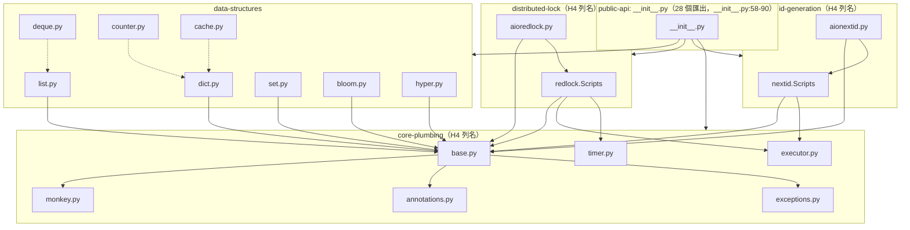

# Issue #9 S5：架構、測試、相依、風險盤點（A1–A4）

| 項目 | 內容 |
| --- | --- |
| 工作項 | [agent-playground/pottery#9](https://github.com/agent-playground/pottery/issues/9) |
| 任務類型 | `agent-analyze`（分析型，不產生程式碼變更） |
| 流程步驟 | S5（P1）＝ **A1 架構／A2 測試／A3 相依／A4 風險**（`per: system`） |
| 目標 repo | `agent-playground/pottery` |
| 基準分支 | `software-factory` |
| 變體 | a |
| 量測日期 | 2026-11（本次 run 實測） |
| 本次變更 | 只新增本報告 `docs/research/9-s5-a1-a4-inventory.md` |
| 狀態 | S5 盤點完成；所有「建議」不具放行效力，待 HG6／HG2 人類裁定 |

---

## 0. 範圍與依據

Issue #9 的「需求描述（PRD）」只有一句「S 流程的 S5 步驟」，三條 DoD 是表單固定文字（與 Issue #7 同形）。為避免猜測，本報告先以工廠流程定義還原 S5 的可驗收內容：

- 機制 repo `templates/factory/S.yaml:42-48`：`S5` → `架構、測試、相依、風險盤點（A1–A4）`、`task_type: agent-analyze`、`per: system`、`gates: [HG6]`。
- `docs/29-brownfield-adoption-playbook.md:420`（§9.1 對照表 S5 列）：工單＝**`agent-analyze`（A1、A2、A3、A4）各 × 1**，機械閘門＝「4 份報告 PR 合併」，HG＝HG6。
- 同文件 §7.1（:194）：A1–A4 各自的「報告須包含」清單；§7.2（:243）：小型專案 A1 一份、A2–A4 各一份。

**派發偏差（誠實記錄，不是自行擴大範圍）**：流程原意是四張標準分析單，但 aswf.dev 表單把 S5 派成了**一張** Issue（#9）。本報告據此把 A1–A4 四題合於一份五段式報告、各題以獨立小節涵蓋，並在 §6 逐題對照 §7.1 檢核項——內容等同四份，便於人類一次審或要求拆單。若人類認為必須「4 份報告 PR」逐張送審，請更新 Issue 重跑或開三張新單；本單不再重複交付。

**範圍限制**：只讀取與量測。不改 `pottery/`、`tests/`、設定、`.github/`、`catalog-info.yaml`、依賴；本次 diff 只有本報告。§2.4 引用 `.github/factory/risk-paths.yml` 是**閱讀**風控設定（非修改），該檔為人類 2026-11-01 放置的有效版（下文稱「repo 內 H 設定」）。

前置：Issue #7 的 A0 報告（`docs/research/7-a0-scale-readiness.md`，已合併）建議規模＝小型、就緒度＝R2（條件式）；HG2 尚未見簽核紀錄。S5 的「份數」依 §7.2 小型列執行；若 HG2 改判中型，A2–A4 要按模組重開，本報告届时只算系統級初稿。

---

## 1. 結論摘要

1. **A1 架構**：19 個 `pottery/*.py` 模組、單一依賴方向（領域層 → `base/annotations/exceptions/monkey` 共用層）、無循環 import（本次以 `ast` 重算，見 §2.1）。五個 bounded context 與 A0 一致；**新發現**：async 雙胞胎不是獨立實作——`AIORedlock` 直接 `import` 同步 `redlock.Scripts`（`aioredlock.py:62-67`）、`AIONextID` 共用 `nextid.Scripts` 與 `_KEY_PREFIX`（`aionextid.py:39-43`），即 Lua 腳本層是 sync/async 共用接縫，協議邏輯才是雙實作。
2. **A2 測試**：以 CI 同款指令對 Redis 7 服務容器重跑 **323 passed／25.24s、行 1854、分支 380、0 missing（100%）**；267 個 `test_*` 函式（ast 實數）。但 100% 是**扣除 16 條 `# pragma: no cover` 後**的數字，且這 16 條恰好集中在 quorum 表決（`redlock.py:494`、`nextid.py:204/239/270`）、acquire 超時耗盡（`redlock.py:425-427`、`aioredlock.py:364-366`）、cache 樂觀鎖重試（`cache.py:291/303/315`）——正是最不能錯的語意。`WatchError` 在 `tests/` 零引用。建議 5 張 add-tests 單（§5.2）。
3. **A3 相依**：`pip-audit -s osv` 掃 `requirements.txt` 全 55 個 pin：**無已知漏洞**；查到的 19 個主要套件 17 個已 pin 在 PyPI 最新版。**實質發現一項錯配**：`types-redis==4.6.0.20241004`（stub 終年 2024-10，描述 redis-py 4.6 API）對應 runtime `redis==8.1.0`，且實測 redis 8.1.0 wheel **已自帶 `redis/py.typed`**——mypy 依 PEP 561 優先取 `types-*` stub，等於用七年前的介面檢查今天的程式碼。另有 `python_requires='>=3.10'`（`setup.py:71`）vs CI 矩陣 3.11–3.15 的既知不一致（A0 遗留，本單確認仍在）。
4. **A4 風險**：repo 內 H 設定把 H4 列名七檔（`base/monkey/redlock/aioredlock/nextid/aionextid/executor`）、H7 列 `pottery/__init__.py`。近一年（fetch 窗口 2025-11-01→HEAD，70 commits）變動频率最高的程式碼檔案與 H 命中**交集**為：`pottery/__init__.py`（5 次，含**兩檔公開類別被移除**：`a1a762f` 刪 queue、`861a2c8` 清 `__all__` 殘名——H7 語意的真實破壞性活動）與 H4 六檔各 3 次。**核心模組建議維持 A0 初判**：distributed-lock、id-generation（＋序列化共用層 `monkey.py`）。驗證工具初判：Redlock／NextID 協議 → Quint；PotteryEncoder JSON 往返 → PBT（Python 用 Hypothesis，非 Hegel）。
5. **Issue #9 DoD**：REQ-1／REQ-2／REQ-3 三條皆涵蓋（§6）。Repo 的 CI 在 `software-factory` 從未觸發（`gh api …/actions/runs` → `total_count=0`，本次複測），故 REQ-3 以本地重跑 CI 指令作替代證據，判定標準沿用 A0——此缺口需要人類工作項修（§5.1）。

### 決策卡（全部僅建議）

| 決策 | 建議值 | 主要證據 |
| --- | --- | --- |
| S5 交付形式 | 一單四題合併報告 | 表單只派一張；§0 偏差記錄 |
| 共用接縫（seam）盤點 | Lua `Scripts` mixin 層、`Container` mixin 組成、`_default_redis` 連線注入點、序列化層 | §2.1 |
| 測試真實強度 | 執行覆蓋 100%，語意缺口集中在 quorum/超時/重試 16 條 pragma | §2.2 |
| 第一個 update-deps 單 | 移除 `types-redis`＋mypy/flake8 小版本對齊＋python_requires 裁決 | §2.3 |
| 核心模組（HG2 認定用） | distributed-lock、id-generation、序列化共用層 | §2.4 |
| S10 驗證路徑初判 | Redlock→Quint；monkey/bloom 序列化→Hegel 路徑（Python＝Hypothesis，人類代行） | §2.4、docs/29 §10 |

---

## 2. 證據與根因

### 2.1 A1 — 架構與模組盤點

**量測方法**（可重現）：對 `pottery/*.py` 逐檔 parse `ast`，收集 `ImportFrom(level≥1)` 得套件內相依圖；結果與下列 Mermaid 一致。原始輸出存於本次 run（方法同 §2.1 指令，無外部工具）。



**模組職責與介面**（對外契約以 `__init__.py` 的 `__all__` 為準，28 個名稱）：

| Context | 檔案 | 職責 | 對外介面（節選） |
| --- | --- | --- | --- |
| core-plumbing | `base.py`(255)、`monkey.py`、`annotations.py`、`exceptions.py`、`executor.py`、`timer.py` | mixin 鏈 `Container=_Common+_Encodable+_Clearable+_Pipelined+_Comparable`（`base.py:278`）；`Primitive`/`AIOPrimitive`（:290/:334）；`BailOutExecutor.__exit__` 走 `shutdown(wait=False)`（`executor.py:53-58`） | 被 11 個模組 import（repo 內 H 設定 §H4 註解，本次 import 圖復核一致） |
| data-structures | dict/list/set/deque/counter/bloom/hyper/cache | Redis 鍵值容器＋Bloom/HLL＋`CachedOrderedDict`/`redis_cache` | `RedisDict` 等 8 類 |
| distributed-lock | `redlock.py`(394)、`aioredlock.py`(267) | Redlock quorum、Lua acquired/extend/release（`redlock.py:101-143` ClassVar 延遲註冊、程序碼常駐 class 層） | `Redlock`、`AIORedlock`、`synchronize`（`redlock.py:680`） |
| id-generation | `nextid.py`(163)、`aionextid.py`(114) | Lua CAS 單調 ID、quorum 讀寫（`nextid.py:204/239/270`） | `NextID`、`AIONextID` |
| public-api | `__init__.py`(60) | 匯出面＋`py.typed` 契約 | 28 exports |

**共用資料/資源所有權**：每物件一個 Redis key（`base.py:88-135 _Common`），連線來源＝构造參數 `redis=` 或環境 `REDIS_URL` 預設單例 `redis://localhost:6379/0`、`socket_timeout=1`（`base.py:52-53`）。值一律 JSON blob 存 string（`base.py:143 json.dumps(sort_keys=True)`），集合型別以自訂編碼在 `set.py`/`bloom.py` 等；`monkey.py` monkey patch `json.dumps` 讓 `set/frozenset` 可序列化（`PotteryEncoder`）。**跨物件共用狀態只有 Lua 腳本快取（class-level）與 event loop 策略（測試 conftest 全域 `uvloop.install()`，`tests/conftest.py:26-36`）**。

**候選接縫（seam）**：
1. **連線注入**：`_default_redis` 常駐、`Container.__init__(redis=…)` 參數化——換 mock／cluster 的切入點（`base.py:93-135`）。
2. **序列化層**：`_Encodable._encode_value` ＋ `PotteryEncoder`（`base.py:137-143`、`monkey.py`）——可換 msgpack 等，但屬 H4。
3. **Lua 腳本層**：`redlock.Scripts`／`nextid.Scripts` 已被 async 側共用（`aioredlock.py:63`、`aionextid.py:40`）——協議驗證時「一份腳本、兩種宿主」的接點。
4. **quorum 表決＋BailOutExecutor**：`redlock.py:475-501`、`nextid.py:185-209` 的 scatter/gather＋早返回——換多數派/quorum 模型的切入点（H4）。

**推斷的設計決策**（每條均為推斷，待人類確認；docs/29 §7.1 A1）：
- D1：drift 因子取 `0.01`＋2ms（`redlock.py:230,315-316`），**非** Redlock 論文的 1/3——推斷採「雲端環境鐘差小」假設；風險：跨資料中心部署時有效性時間高估。
- D2：Lua 腳本以 ClassVar 每 master 註冊一次（`redlock.py:86-102`）——推斷為省 NISKMA/記憶體的重用最佳化。
- D3：sync/async 雙胞胎共用腳本、**不共用**協議邏輯——推斷為「避免 async 等待 sync executor」的代價性重複；重構候選。
- D4：`BailOutExecutor.shutdown(wait=False)`（`executor.py:58`）——推斷為了 quorum 湊齊即返的延遲，代價是落單執行緒續跑；`test_executor.py` 有 8 處 sleep，語意靠時間取樣。
- D5：測試即文件——大量 doctest（`tests/test_doctests.py:48-67` 跑 19 模組＋README），推斷故意以可執行文件當契約。

### 2.2 A2 — 測試現況與缺口

**框架與執行方式**：pytest 9.2.0＋pytest-asyncio（`asyncio_mode=auto`，`pytest.ini:24-25`）＋doctest；event loop 由 conftest 換成 uvloop。CI 指令（`.github/workflows/python-package.yml:40-50`）：`pytest --cov=pottery --cov=tests` → mypy → flake8/isort → bandit。矩陣 3.11–3.15＋Redis service（:17-29）。

**本次重跑**（本地 Redis 7-alpine 容器＝CI 同款服務；非 E2E）：

```bash
/tmp/pv9/bin/python -m pytest --cov-config=.coveragerc --cov=pottery \
  --cov-report=term-missing --cov-report=json:/tmp/cov9.json -q
# → 323 passed in 25.24s；TOTAL 1854 stmt / 380 branch / 0 missing → 100%
# → 19 個 pottery/*.py 全部 100%
```

測試規模：267 個 `def test_*`（ast，`tests/test_*.py`）＋doctest/parametrize 展開＝323 case；斷言密度：`test_redlock.py` 31 函式/71 assert、`test_aioredlock.py` 19/22、`test_nextid.py` 10/10。失敗注入存在：`test_redlock.py:243-298` 以 `side_effect=TimeoutError` 打樁 extend/release 腳本；多 master 測試以同一 Redis 實例的 3 個邏輯 db 冒充 3 個 master（`test_redlock.py:305-307`）。

**覆蓋率分母被什麼扣掉**——16 條 `# pragma: no cover` 被 `.coveragerc:27-28` 的 `exclude_lines` 排除，分布：`nextid.py`×3（:204 quorum 讀、:239 quorum 寫、:270 全數 reset 檢查）、`redlock.py`×3（:425-427 blocking 超時耗盡、:494 quorum 表決）、`aioredlock.py`×2（:364-366）、`cache.py`×3（:291/:303/:315 含 `except WatchError` 重試）、`base.py`×2、`counter.py`×1、`monkey.py`×1、`aionextid.py`×1。**根因推断（待人類確認）**：上游把「單 master 測試環境難以穩定觸發」的多數派分支標了 no cover，等於把最關鍵的表決語意移出可觀察範圍——100% 是「考卷上沒有難題」的 100%。

**其他語意缺口**（逐條可查證）：
- `tests/` 全目錄 `WatchError` 零引用 → `redis_cache` 的 transaction 重試路徑完全未測（`cache.py:315`）。
- `redlock.acquire()` 超時耗盡傳回 False 的分支（`redlock.py:425-427`）標 no cover，僅靠 doctest 的 timeout 情境邊緣觸及。
- 時序敏感測試 26 處 sleep（executor 8、cache 6、redlock 6、timer 4、aioredlock 2）——慢機/CI 抖動下為 flaky 候選。
- RedisQueue 移除後 `QueueEmptyError` 仍在匯出面（`exceptions.py:40`、`__init__.py:34,64`）但套件內無任何使用點——殘留公開名稱，無回歸防護（盤點副产品，屬 H7 面）。

**add-tests 優先序**：見 §5.2（T1–T5，每項一個檔案＋驗收條件草案）。

### 2.3 A3 — 相依健康度

** runtime 面（`setup.py:72 install_requires`）**：`redis>=4.2.0rc1`、`mmh3`、`typing_extensions`（無上界）；`requirements.txt` 全 pin。`hiredis` 只出現在 requirements/freeze（`requirements-to-freeze.txt:22` 區），不在 install_requires——選擇性加速精簡依赖；uvloop 同理僅測試路徑用（`tests/conftest.py:26`）。

**pin vs PyPI 最新（curl `pypi.org/pypi/<p>/json`，本次實查 19 個）**：

| 套件 | pin（requirements.txt 行） | 最新 | 落後 |
| --- | --- | --- | --- |
| redis | 8.1.0（:41） | 8.1.0 | 0 |
| mmh3 | 5.3.1（:23） | 5.3.1 | 0 |
| typing_extensions | 4.16.0（:53） | 4.16.0 | 0 |
| hiredis / uvloop | 3.5.0 / 0.23.0（:10/:55） | 同 | 0 |
| pytest / pytest-asyncio / pytest-cov / coverage | 9.2.0 / 1.4.1 / 7.1.0 / 7.17.0 | 同 | 0 |
| bandit / isort / twine / cryptography / requests / urllib3 / PyJWT / PyYAML | （見 requirements.txt） | 同 | 0 |
| **mypy** | 2.4.0（:25） | 2.4.1 | **1** |
| **flake8** | 7.4.1（:9） | 7.5.0 | **1** |
| **types-redis** | 4.6.0.20241004（:51） | 4.6.0.20241004 | 0（**但見下**） |

**CVE**：`pip-audit -r requirements.txt -s osv`（55 packages）→ **`No known vulnerabilities found`**（exit 0）。無優先級 CVE 工作項。

**實質發現——stub/runtime 錯配（本次驗證）**：
1. `types-redis` 最後發佈 2024-10（PyPI 查詢），描述 redis-py ~4.6 介面；runtime 是 8.1.0。
2. 解壓 redis 8.1.0 wheel 實測內含 `redis/py.typed`（PEP 561 inline hints）。
3. mypy 的 stub-precedence 讓 `types-*` 蓋過自帶 hints → 型別檢查以過時介面為準；「未落後」是假象，該套件應**移除**而非升級。
4. 附帶：`python_requires='>=3.10, <4'`（`setup.py:71`）vs classifiers 3.11+（`setup.py:55-69`）vs CI 矩陣 3.11–3.15（workflow :17）——三處不一致原樣存在（A0 遗留）。

**維護狀態**：上表套件皆活躍；`types-redis` 屬「事實停更」（被 redis-py 自帶 hints 取代）。`requirements-to-freeze.txt` 的 `redis>=4.2.0rc1` 無上界，發佈件消費端有 API 漂移暴露面（註記，非缺陷）。

### 2.4 A4 — 風險熱點

**命中 risk-paths.yml H1–H7 的路徑**（以 **repo 內有效版** `.github/factory/risk-paths.yml` 為準；H1–H3/H6 已由人類裁定為 `[]`（:26/:32/:45/:102，附零命中證據註解））：

| 規則 | 列名檔案 | 存在性（本次 glob 實測） |
| --- | --- | --- |
| H4（:51-70） | `pottery/base.py`、`monkey.py`、`redlock.py`、`aioredlock.py`、`nextid.py`、`aionextid.py`、`executor.py` | 7/7 存在 |
| H5（:83-95） | `.github/**`、`CODEOWNERS`（不存在）、`catalog-info.yaml`、`.dsh/skills/**`（不存在） | `.github/workflows/python-package.yml` 等 6 檔命中 |
| H7（:107-114） | `pottery/__init__.py` | 存在 |

**近一年變動頻率**（方法：`git fetch --shallow-since=2025-11-01 origin master` 後 `git log FETCH_HEAD --pretty=format: --name-only | sort | uniq -c`；窗口內 70 commits；工廠 trunk `software-factory` 本身僅 1 個 snapshot commit，無歷史可用——**根因：S3 搬檔重開歷史**，故以 master 血統作程式碼演化代理，fork 前綴相同檔案）：

- 全 repo 前導：`requirements.txt` **42**、`Makefile` 11、`tests/conftest.py` 8、`tests/test_doctests.py` 5、`pottery/__init__.py` 5、workflow 5、`setup.py` 4、`pottery/deque.py` 4。
- `pottery/*.py`：`__init__.py` 5、`deque.py` 4、`set/redlock/queue(已刪)/nextid/monkey/list/executor/exceptions` 各 3。

**交集（H 命中 ∩ churn）**：
1. **`pottery/__init__.py`＝H7 ∩ 程式碼類最高 churn（5）**，且窗口內有**真實破壞性變更**：`a1a762f`「remove my idiotic queue」刪 `RedisQueue`/`RedisSimpleQueue`，`861a2c8` 補清 `__all__` 殘名——驗證 H7 列此檔的取捨正確；殘留 `QueueEmptyError` 匯出（§2.2）是後續。
2. **H4 的 lock/id/serialization 六檔**各 3 次——改動與高風險面重疊。
3. `requirements.txt` 42 次＝依賴輪替頻率極高的**流程**熱點（不在 H 路徑，但每次輪替都是 update-deps 候選；本單 A3 即其產物）。
4. `pottery/deque.py`：4 次，含上游缺陷修復 `bc63050 "Fix RedisDeque.rotate() for abs(n) > len(d)"`；本次讀 snapshot 確認修復**已包含**（`deque.py:158-160` wrap-around 註解），且有邊界測試（`tests/test_deque.py:135`）。教養性發現：缺陷會落在「H4 以外」的容器層——H4 只列名 lock/id/共用層的取捨（風險配置 :71-79）值得人類在 HG6 再確認一次。

**建議核心模組清單（僅建議，HG2 認定；沿用並補強 A0 初判）**：
1. `distributed-lock`（`redlock.py`+`aioredlock.py`）：失敗模式=雙持鎖靜默；H4；drift 因子非論文值（D1）。
2. `id-generation`（`nextid.py`+`aionextid.py`）：失敗模式=ID 重複/非單調；H4；quorum 分支無覆蓋訊號。
3. `serialization core`（`base._Encodable`+`monkey.py`，H4）：失敗模式=所有容器資料破損。

**Quint／Hegel 適用性初判**（docs/29 §10.1，:646-）：
- Redlock／NextID：狀態機＋協定＋時序（quorum、TTL、drift、CAS）→ **Quint**（S10 `agent-write-spec`；規格來源須人類撰寫，§10.2 紅線，不得取材本報告）。
- `PotteryEncoder`/`json.dumps` 往返、bloom/hyper 索引數學：輸入空間大的純函式合約 → **PBT**；**注意語言映射**：Python 沒有 Hegel runtime，ADR-019 §1 指定 Python 用 Hypothesis——pbt-audit 目前無 Python 試點紀錄，初期依 §10.4 由人類代行或走豁免單。
- containers（dict/list/set…）：定義域被 Redis 語意綁住，兩者皆非首選→建議維持範例測試＋S8 補強。

### 2.5 根因整合（為什麼是這些缺口）

1. **覆蓋率訊號失真**：pragma 慣例（測試環境難以穩定觸發多數派分支）＋ 單實例多 logical-db 冒充多 master（`test_redlock.py:305-307`）→ quorum 語意「不可測地被測過」。根因是測試拓撲，不是斷言數量。
2. **型別防護過時**：`types-redis` 存在本身是歷史包袱（redis-py ≥4.2 前無 inline hints），移除=更新。
3. **CI 觸發缺口延續**：workflow 只綁 `master`（:6-10），`software-factory` 上 PR 零 CI 訊號（`actions/runs total_count=0`，本次複測）；這是 A0 判 R2「條件式」的唯一阻因，本單確認未修。
4. **棕地流程性根因**：表單把 S5 派成一單（§0）；HG2 尚未簽核即進入 S5 工單——人類閘門與派工順序的落差，記錄供 aswf.dev 表單／引擎修正參考。

### 2.6 量不到與限制

| 項目 | 狀態 | 原因與影響 |
| --- | --- | --- |
| `software-factory` 上的 CI 綠燈 | **量不到（total_count=0）** | workflow 只綁 master；`.github/**`=H5，agent 不得修（SR3）。REQ-3 以本地同指令重跑替代（沿用 A0 標準）。 |
| 3.10–3.15 全矩陣 | 未逐一重跑 | 本地僅 3.14.4；py3.10 支援性仍無證據（A3 發現 4）。 |
| mypy／flake8／bandit 重跑 | 未執行 | 本次僅跑 pytest（DoD 第三條）；移除 types-redis 的 mypy 影響由 update-deps 單的 AC 承擔。 |
| 上游 brainix/pottery 真實多 master 部署行為 | 量不到（不在 repo） | 僅能就程式碼語意分析。 |
| medium 規模下的份數正確性 | 取決於 HG2 | §0：若判中型，A2–A4 需每模組重開。 |
| software-factory 分支自身的 churn | 量不到（歷史 1 commit） | 以 master 血統代理，§2.4 已標明方法與根因。 |

---

## 3. 影響範圍

**受影響模組（分析對象本身）**：
- A2 缺口直接波及：`cache.py`（WatchError 重試）、`redlock.py`/`aioredlock.py`（acquire 超時、quorum）、`nextid.py`/`aionextid.py`（quorum 讀寫）——全在 H4。
- A3 波及開發者型別檢查體驗（全 repo mypy 結果的真實性）與發佈端（`setup.py` 三處版本宣告不一致）。
- A4 波及 `pottery/__init__.py`（H7）與容器層（deque 前科）。

**受影響使用者／下游**：
- PyPI 消費者：型別 stub 錯配可能誤導用 redis-py 8 API 寫 pottery 擴充的開發者；`redis>=4.2.0rc1` 無上界讓新版本行為漂移落到用客端。
- Redlock/NextID 用客（併發正確性）：quorum 語意無覆蓋訊號＝缺陷最可能靜默抵達用客的模組。
- 移除 queue 的既有破壞性變更：仍 `import pottery` 取 `RedisQueue` 的舊用客升級 3.x 即斷——文件（S6）需如實記載。

**對工廠流程**：
- 本報告是 S7B「確認模組清單」的預填來源（S.yaml S7B 註解）：建議清單＝§2.4 三核心＋五 context。
- S8 的 add-tests 清單由 §5.2 T1–T5 直接開單；S10 核心模組擇一驗證路徑的初判由 §2.4 提供；A3 的 update-deps 候選進 S11/提前單。
- REQ-3 的「本地替代 CI 證據」標準若 HG6 不接受，P1 所有 analyze 單的「驗證方式」都要改用 H-CI 修復後的真實 CI——牽動流程定義，不只是本單。

**本次變更的影響**：diff 僅 `docs/research/9-s5-a1-a4-inventory.md`；未觸碰任何 H1–H7 路徑（H4/H7 檔案為唯讀引用）。

---

## 4. 方案比較

| 方案 | 內容 | 優點 | 為何採用／拒絕 |
| --- | --- | --- | --- |
| **A（採用） delivery** | 一單涵蓋 A1–A4 四題於本報告，§6 逐題檢核，偏差記錄在 §0 | 與表單實際派發一致；人類可一次完成 HG6 材料；不虛增 PR | **採用**。§9.1「4 份報告 PR」與單張 Issue 的矛盾屬派工層，標記交人類裁定，不擅自補開 Issue（範圍控制是人的判斷，SR8 的精神）。 |
| B（拒絕）delivery | 依停手規則 4/8：主題未指明→needs-human 零交付 | 形式最保守 | **拒絕**：S5 主題在機器可讀流程定義中完全確定（A1–A4），Issue #7 已確立「還原流程定義」且被人類合併；零交付會讓 N-version 比對無物、HG6 無材料。 |
| C（拒絕）delivery | 只做 A1–A4 其中一題（例如 A2） | 每單主題純淨 | **拒絕**：四选一毫無依據＝猜測；且漏掉的三題仍是 S5 機械閘門。 |
| **A'（採用）A2 判定** | 把 100% 覆蓋率拆穿為「扣除 16 pragma 的 100%」，缺口逐條列證 | 直指 quorum/重試語意，產生可執行 add-tests | **採用**。 |
| B'（拒絕）A2 判定 | 依 A0 數字照錄「覆蓋充分、無缺口」 | 與前單一致、省事 | **拒絕**：可機械反證（pragma 清單＋WatchError 零引用）；照錄等於掩蓋 P1 最重要的語意缺口。 |
| **A''（採用）A3 處置** | 一張小型 update-deps：移 `types-redis`、mypy→2.4.1、flake8→7.5.0，附 mypy/測試綠燈 AC | 無 CVE 壓力下最小變更面；修掉型別防護失真 | **採用**（開單建議，本單不实作）。 |
| B''（拒絕）A3 處置 | 全矩陣升到各套件最新版（含 transitive 重凍結） | 一步到位 | **拒絕**：pip-audit 已證零漏洞，大版本輪替徒增 42 次/年 churn 的迴滾風險；依 §7.2「update-deps 通常是單一 PR」的精神做窄幅。 |
| C''（拒絕）A3 處置 | 保留 `types-redis`「以防 redis hints 不全」 | 保守 | **拒絕**：wheel 實測含 `py.typed`；保留=持續用 4.6 介面蓋 8.1 實作。 |
| A4 工具初判 | lock/id→Quint；序列化→Hegel 路徑但以 **Hypothesis（Python 映射）**執行或豁免 | 依 docs/29 §10.1 分工＋ADR-019 §1 語言規則 | **採用**（初判）。拒絕「直接宣稱 pbt-audit 可跑」：無 Python 試點紀錄，§10.4 由人類代行。 |

---

## 5. 建議下一步

### 5.1 HG6／HG2（人類閘門，不開工單）

- **做什麼**：HG2 補簽（規模/R 等級/核心模組，材料：#7 報告 §1 + 本報告 §2.4）；HG6 依本報告出 P1，並裁定：(a) S5 一單四題的交付形式是否接受「4 份報告 PR」的機械閘門達成方式；(b) T1–T5 add-tests 清單；(c) deque 前科是否納入 H4（§2.4 交集 4 的取捨）。
- **驗收條件草案**：導入追蹤 Issue 出現 HG2/HG6 簽核留言（簽核人、日期、採納清單），S7B 的 `modules` 變數被填入。

### 5.2 S8 add-tests 工作項（`agent-add-tests`，每項一檔；直接開單）

| # | 目標檔案 | 做什麼 | 驗收條件草案 |
| --- | --- | --- | --- |
| T1 | `pottery/cache.py` | 注入 `WatchError` 測重試路徑（:315） | 新測試：首次 EXEC 拋 `WatchError` → 重試後回傳正確值；該 pragma 移除後覆蓋率仍綠；不動實作。 |
| T2 | `pottery/redlock.py` | blocking acquire 超時耗盡回傳 False（:425-427） | 新測試：短 `auto_release_time`＋雙執行緒互斥→取得端 False＋`enqueued` 日誌分支執行；移除該二 pragma 行標記。 |
| T3 | `pottery/aioredlock.py` | T2 的 async 等價（:364-366） | 同 T2 改 asyncio 版；斷言一致。 |
| T4 | `pottery/nextid.py` | quorum 讀寫與全數 reset 檢查（:204/:239/:270） | 用 3 masters（真 3 實例或穩定 stub）測多數派寫入／`QuorumNotAchieved`；三條 pragma 至少轉為有断言執行紀錄。 |
| T5 | `pottery/redlock.py`（拓撲升級） | 真實多 master 故障注入：獨立埠 Redis×3，kill 其一/其二 | `locked()`/`acquire()` 在 1/3 down 時 quorum 仍成、2/3 down 拋 `QuorumNotAchieved`；需 RedisError 注入註記 `raise_on_redis_errors` 語意。 |

（每張單都受「新增測試必須在既有實作上直接綠燈」約束：若揭露缺陷，依 agent-add-tests 規則 `it.skip` 交付＋另開 S9 fix-bug。T5 可能需要服務容器矩陣擴充，超出 R0 限制但**不在本單實作**。）

### 5.3 S-U3 `agent-update-deps`（可直接開單）

- **做什麼**：移除 `types-redis`（requirements.txt:51）；mypy 2.4.0→2.4.1（:25）；flake8 7.4.1→7.5.0（:9）。
- **驗收條件草案**：(1) 全量 pytest 323＋綠；(2) `mypy` 以 redis 內嵌 hints 通過、無新增 error（若有，逐條列入 PR 描述）；(3) `pip-audit -r requirements.txt` 零漏洞；(4) 不動 `setup.py` 依賴宣告。

### 5.4 S6 `agent-write-docs`（輸入清單）

- README/架構總覽需涵蓋：五 context 圖（§2.1）、**已移除的 RedisQueue/RedisSimpleQueue 與殘留 `QueueEmptyError`**（破壞性變更記載）、Linux 安裝路徑（A0 次要觀察 2）、`python_requires` 三處宣告之最終裁決、hiredis/uvloop 的選用性說明。

### 5.5 S10 驗證閘門準備（人類前置）

- HG4：為 `distributed-lock`／`id-generation` 撰寫業務規則文件（`docs/business-rules/`，領域專家逐條確認，§10.2 紅線：不得取材本報告或 README 的 agent 產出）——這是 write-spec 不變量階段的唯一合法來源。
- Hegel 路徑：Python pilot（Hypothesis 映射）需人類先試點或豁免單（§10.4）。

### 5.6 H-CI（人類，沿 A0 §5.2 未消化）

- workflow trigger 擴及 `software-factory`＋required check。驗收條件見 #7 報告 §5.2（四條），本次複測 `total_count=0` 確認未修——**這是 P1 機械閘門可信度的前置**。

### 5.7 流程回馈（給 aswf.dev／引擎的人類事項）

- 表單把 S5「A1–A4 各×1」派成一張 Issue：請裁定「一單合題」與「自動拆四單」何者為預設，並同步 §9.1 機械閘門文字（本次以偏差記錄處理）。

---

## 6. Issue #9 驗收條件對照 ＋ A1–A4 檢核對照

**Issue DoD（表單固定三條）**：

| ID | Issue DoD 原文 | 狀態 | 涵蓋方式 |
| --- | --- | --- | --- |
| REQ-1 | 有可驗證的測試/驗證方式（測試紅→綠或明確驗證命令） | **passed** | §2.2 重跑指令與結果（323 passed）、§2.3 `pip-audit` 指令與輸出、§2.4 churn 指令、§2.1 import 圖方法；A1–A4 每條檢核項（下表）附可查證 file:line。 |
| REQ-2 | 不觸碰高風險路徑（H1–H3 等硬規則） | **passed** | diff 僅本報告；本 repo 有效 H 設定中 H1–H3 為 `[]`（risk-paths.yml:26/:32/:45），亦未觸碰 H4/H5/H7 任何列名路徑（唯讀引用）。 |
| REQ-3 | 跑測試確認綠燈（不跑需外部服務的 E2E） | **passed** | 本地 CI 同款 pytest 指令＋CI 同款 Redis 7 服務容器：323 passed、exit 0；無 E2E。真實 CI 訊號缺口與替代證據標準同 §2.6（沿 A0 口徑，待 HG6 追認）。 |

**docs/29 §7.1 四題檢核項對照**（供 HG6 逐題核對）：

| 檢核項 | 涵蓋位置 | 狀態 |
| --- | --- | --- |
| A1：容器/模組圖、職責、呼叫與共用資料表、候選接縫、推斷決策標註 | §2.1（Mermaid＋表＋seam 1–4＋D1–D5 全標「推斷待確認」） | 已涵蓋 |
| A2：框架與執行方式、各模組覆蓋率、未覆蓋關鍵路徑、add-tests 清單（每項一檔＋AC 草案） | §2.2 ＋ §5.2 T1–T5 | 已涵蓋 |
| A3：相依清單與落後版本數、CVE 編號與嚴重度、update-deps 工作項（CVE 類優先） | §2.3（落後=mypy/flake8 各 1；CVE=OSV 零命中，故無優先級項）＋ §5.3 | 已涵蓋（無 CVE 屬實測結果，非迴避） |
| A4：H1–H7 命中路徑、近一年 churn、交集、核心模組建議、Quint/Hegel 初判 | §2.4（有效版 risk-paths＋master 血統 churn＋交集 4 條＋核心 3 項＋§10.1 映射） | 已涵蓋 |

---

## 7. 給人類審查者的三句話

1. **100% 覆蓋率是真的，但考卷刪了最難的題**：16 條 pragma 剛好排除了 quorum、超時耗盡與樂觀鎖重試——T1–T5 五張 add-tests 單把這些題加回來。
2. **相依沒有洞、但防護在用舊地圖**：OSV 零漏洞；`types-redis`（2024 年的 4.6 介面 stub）蓋掉了 redis 8.1.0 自帶的型別註解，移除它比升級任何套件都重要。
3. **S5 被派成一張單**：本報告以一檔涵蓋 A1–A4 並在 §0/§5.7 記錄派發偏差；請在 HG6 連同 H-CI（CI 仍未接上工廠 trunk）一起裁定。
