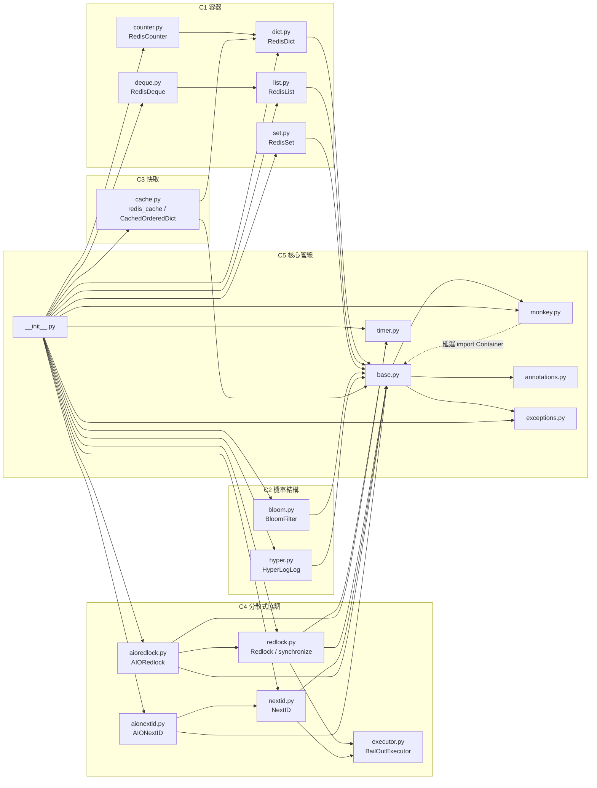

# Issue #9 S5：pottery 架構、測試、相依與風險盤點（A1–A4）

| 項目 | 內容 |
| --- | --- |
| 工作項 | [agent-playground/pottery#9](https://github.com/agent-playground/pottery/issues/9) |
| 任務類型 | `agent-analyze`（分析型；不產生程式碼變更） |
| 流程步驟 | S5（P1）＝ **A1 架構／A2 測試／A3 相依／A4 風險** |
| 目標 repo | `agent-playground/pottery` |
| 基準分支 | `software-factory`（HEAD `95529b0`） |
| 參考上游 | `brainix/pottery` HEAD `2d7c70a`（2026-10-28；本地 repo 的歷史被 squash／shallow，見 §7） |
| 變體 | b（分支 `factory/9-b-01-docs`） |
| 分析日期 | 2026-11-01 |
| 本次變更 | 只新增本報告 `docs/research/9-s5-a1-a4-inventory.md` |
| 狀態 | 分析完成；核心模組、Python 下限與候選發現**均待人類裁定**，本報告不具放行效力 |

---

## 0. 範圍、依據與判讀

### 0.1 Issue #9 的模糊處

Issue #9 的「需求描述（PRD）」只有一句「S 流程的 S5 步驟」，三條 DoD 是表單固定文字；Issue 檢查機器人已在留言中指出「沒有本 Issue 專有的可驗證條目」。為避免猜測，本報告以工廠流程的 S5 定義還原可驗收內容：

- `templates/factory/S.yaml:41-46`：S5＝「架構、測試、相依、風險盤點（A1–A4）」、`task_type: agent-analyze`、`per: system`、`gates: [HG6]`。
- 機制 repo `docs/29-brownfield-adoption-playbook.md` §9.1 表格（第 420 列）：S5 要開「`agent-analyze`（A1、A2、A3、A4）各 × 1」，機械閘門是「4 份報告 PR 合併」。
- 同文件 §7.1 逐張定義 A1–A4 報告必須回答的問題；§7.2 規定小型專案 A1／A2–A4 各 1 份。

### 0.2 本報告的切分方式

Issue #9 是**一個** S5 工作項，而本工作項被要求以**單層 PR** 交付，因此本報告把 A1–A4 合併為一份報告的四個章節（§2.1–§2.4），而不是開四顆 PR。這是對「單一 Issue／單層 PR」的貼合，不是縮減 S5 範圍：四張分析單要求的內容都逐項出現在本報告中（對照見 §6.2）。若人類希望拆成四份獨立報告，可依 §5 的 W1 決定後另開工作項。

### 0.3 證據基準與限制

- 目標 repo 的 `pottery/`、`setup.py`、`requirements.txt` 與上游 `brainix/pottery` HEAD `2d7c70a` **逐檔相同**（`diff -q` 無差異）；本地被 squash 成 1 個 commit 且是 shallow clone，所以「近一年 git log 變動頻率」改以上游歷史量測，並在 §2.4.3 明確標示替代來源。
- 測試量測環境：Python **3.14.4**、Redis **7-alpine**（Docker，`localhost:6379`）、`requirements.txt` 的 pinned 依賴。
- 本次 diff 只有本報告；沒有修改 `pottery/`、`tests/`、設定、CI、依賴或 `catalog-info.yaml`。

---

## 1. 結論摘要

1. **架構（A1）**：pottery 是「5 個 context、19 個 Python 模組（＋`py.typed`）、28 個公開名稱」的 Redis 客戶端函式庫。容器（dict/list/set/counter/deque）共用 `base.Container` 的 key／JSON codec／`WATCH-MULTI-EXEC` 管線；分散式鎖與 ID 產生器走另一條路：Lua 腳本＋多 master quorum＋`BailOutExecutor` 提前返回。同步實作是主體，非同步版本**繼承同步模組的 `Scripts` 與類別常數**，形成強耦合（§2.1）。
2. **測試（A2）**：`pytest` 全綠：**323 passed、25.18s、19 個模組行／分支覆蓋率 100%**（1,854 statements／380 branches）。但 100% 是「執行覆蓋」，且有 **16 處 `# pragma: no cover`**；真正薄弱的是語意：至少 **7 條關鍵路徑**沒有被斷言，集中在 quorum 邊界、CAS 失敗注入、非同步 parity、快取競爭重試（§2.2）。
3. **相依（A3）**：3 個直接執行期相依（`redis`、`mmh3`、`typing_extensions`）**全部是最新版**；56 個 pinned 套件中 6 個落後，**OSV 查詢 0 個已知 CVE**，沒有停止維護的套件。唯一結構性問題是 **Python 下限 3.10 與 classifiers／CI 的 3.11–3.15 不一致**：3.10 讓 `flake8`／`pyflakes`／`stevedore` 無法升級，`readme_renderer` 與 `docutils` 則必須成對升級（§2.3）。
4. **風險（A4）**：`risk-paths.yml` 的 H4 命中 **7 個共享／核心檔案**（`base`、`monkey`、`redlock`、`aioredlock`、`nextid`、`aionextid`、`executor`），H7 命中 `pottery/__init__.py`；H1–H3、H6 無命中。近一年上游 70 個 commit／61 個檔案，變動最多的是 `requirements.txt`（42 次），核心模組反而是 2–3 次；**churn 沒有指出新的熱點，風險來自「靜默失敗」語意**（§2.4）。
5. **候選發現**：F1「偶數 master 的 `QuorumIsImpossible` 門檻 off-by-one」已用可重現探針確認；F2「`AIORedlock` 沒有 quorum 提前返回」與 F3「部分參數只存在 client 記憶體、未與 Redis key 綁定」是設計層風險；F4「同步／非同步 `locked()` 的 TTL 選法不同」是低風險語意差異（§2.5）。
6. **建議**：核心模組初判為 **distributed-lock（`redlock`＋`aioredlock`）** 與 **id-generation（`nextid`＋`aionextid`）**，兩者都適合 **Quint**（互斥／quorum／單調性屬狀態機與時序性質）；`base._Encodable`／`monkey` 可另做 Hegel PBT，但不建議列為核心。下一步工作項見 §5；Issue #9 的三條 DoD 已全部涵蓋（§6.1），但**報告不具放行效力**，核心模組與 Python 下限仍須 HG2 人類裁定。

### 決策卡

| 決策 | 建議值 | 主要證據 |
| --- | --- | --- |
| S5 交付形態 | 一份報告含 A1–A4 四章 | 單一 Issue＋單層 PR；四張分析單內容均在 §2 |
| 核心模組（僅建議） | `distributed-lock`、`id-generation` | H4 命中＋靜默失敗型正確性；§2.4.4 |
| 驗證工具初判 | 兩者皆 **Quint** | 互斥、quorum、lease、單調遞增皆為狀態機／時序性質；§2.4.5 |
| Python 下限 | **建議改 3.11**（人類裁定） | classifiers／CI 已只測 3.11–3.15；3.10 卡住 3 個 dev 相依；§2.3.4 |
| 最高優先候選發現 | F1 偶數 master 門檻 off-by-one | 可重現探針：n=2、4 未拋 `QuorumIsImpossible`；§2.5.1 |
| 下一個閘門 | **HG6**（S5 出口）；核心模組另待 HG2 | docs/29 §8、§9.1 |

---

## 2. 證據與根因

### 2.1 A1 — 架構與模組盤點

#### 2.1.1 Context 與容器／模組圖

以「對外行為邊界」切成 5 個 context（與 A0 報告的 5 個 context 一致）：



> 圖只畫 `pottery/` 內的 import；`redis`、`mmh3`、`typing_extensions` 是外部相依。邊的來源是 AST 掃描 `from .<module>`，不是手繪猜測。

#### 2.1.2 模組職責

| 模組 | Context | 職責 | 主要對外符號 |
| --- | --- | --- | --- |
| `dict.py` | C1 | 以 Redis hash 實作 `MutableMapping`；key／value 都經 JSON codec | `RedisDict` |
| `list.py` | C1 | 以 Redis list 實作 `MutableSequence`；slice、insert、sort | `RedisList` |
| `set.py` | C1 | 以 Redis set 實作 `MutableSet`；聯集／交集／差集 | `RedisSet` |
| `counter.py` | C1 | 以 `RedisDict` 的 hash 佈局實作 `Counter` 與算術 | `RedisCounter` |
| `deque.py` | C1 | 以 `RedisList` 實作 deque；`maxlen` 只存在 client（§2.1.4） | `RedisDeque` |
| `bloom.py` | C2 | Bloom filter；由 n、p 計算 bit 數與 hash 次數 | `BloomFilter` |
| `hyper.py` | C2 | Redis HyperLogLog 的 Pythonic 包裝 | `HyperLogLog` |
| `cache.py` | C3 | `redis_cache` 裝飾器、`CachedOrderedDict`、`CacheInfo` | `redis_cache`、`CachedOrderedDict` |
| `redlock.py` | C4 | 同步分散式鎖；Lua acquire/extend/release；多 master quorum；`synchronize` | `Redlock`、`synchronize`、`Scripts` |
| `aioredlock.py` | C4 | `Redlock` 的非同步鏡像；重用 `redlock.Scripts` 與類別常數 | `AIORedlock` |
| `nextid.py` | C4 | 同步單調遞增 ID；Lua CAS；多 master quorum | `NextID`、`Scripts` |
| `aionextid.py` | C4 | `NextID` 的非同步鏡像；重用 `nextid.Scripts` | `AIONextID` |
| `executor.py` | C4 | `ThreadPoolExecutor` 子類，`__exit__` 不等待未完成 future，讓 quorum 提前返回 | `BailOutExecutor` |
| `base.py` | C5 | client／key、JSON codec、WATCH 管線、相等比較、`Primitive` quorum 檢查 | `Container`、`Primitive`、`AIOPrimitive`、`random_key` |
| `monkey.py` | C5 | `PotteryEncoder`；**import 時全域覆寫 `json.dumps`** | `PotteryEncoder` |
| `annotations.py` | C5 | 型別別名 | `JSONTypes`、`RedisValues`、`F` |
| `exceptions.py` | C5 | 例外／警告階層 | 12 個例外與警告 |
| `timer.py` | C5 | 毫秒級 wall-clock timer | `ContextTimer` |
| `__init__.py` | C5 | 公開 API 再匯出 | `__all__` 28 個名稱 |
| `py.typed` | C5 | PEP 561 型別標記 | — |

#### 2.1.3 模組間呼叫與共用資料

| 呼叫者 → 被呼叫者 | 呼叫內容 | 共用資料／副作用 |
| --- | --- | --- |
| 所有容器 → `base.Container` | `_watch()`、`_encode()`／`_decode()`、`_same_redis()` | 每個容器一個 Redis key；值為 JSON 字串；多 key 操作用 `WATCH`＋`MULTI`／`EXEC` |
| `RedisCounter` → `RedisDict` | 繼承 hash 讀寫與 `_populate()` | 與 `RedisDict` 相同的 hash 佈局（同 key 可被兩者解讀） |
| `RedisDeque` → `RedisList` | 繼承 list 操作與 `_insert()` | 同一個 Redis list key；`maxlen` 不進 Redis |
| `cache` → `RedisDict`、`base.random_key`、`base._default_redis` | 快取值存放、隨機 key、預設 client | 快取資料在 RedisDict；hits/misses、`_num_tries`、`_timeout` 在 client |
| `Redlock` → `executor.BailOutExecutor`、`timer.ContextTimer`、Lua `Scripts` | 對每個 master scatter／gather；量測 elapsed；註冊 3 支 Lua | key `redlock:<key>`；value 是 `_uuid`；lease TTL 由 Redis 持有 |
| `AIORedlock` → `redlock.Scripts`、`Redlock` 類別常數 | 重用 Lua 腳本註冊與 `_AUTO_RELEASE_TIME`／`_CLOCK_DRIFT_FACTOR` 等 | 與 `Redlock` 相同的 key 前綴與 value 佈局（可互相看到同一把鎖） |
| `NextID` → `executor.BailOutExecutor`、Lua `Scripts` | 對每個 master get／CAS set；註冊 1 支 Lua | key `nextid:<key>`；current ID 在 Redis |
| `AIONextID` → `nextid.Scripts` | 重用同一支 Lua 腳本與 `Scripts` 協定 | 與 `NextID` 相同的 key／value 佈局 |
| `base` → `monkey.logger`、`annotations`、`exceptions` | logger、型別、例外 | `pottery` logger（NullHandler） |
| `monkey.PotteryEncoder.default()` → `base.Container` | **函式內延遲 import**，避開循環 import | 全域 `json.dumps` 被替換（`monkey.py:55`） |
| `__init__` → 所有模組 | 再匯出公開 API | import `pottery` 即執行 `monkey` 的全域 patch |

#### 2.1.4 狀態所有權：哪些 state 在 Redis、哪些只在 client

這是 A1 最重要的邊界，也是 F3 的根因：

| 狀態 | 存放位置 | 證據 | 風險 |
| --- | --- | --- | --- |
| 容器內容（hash／list／set／string） | Redis key | `dict.py:50-64`、`list.py:79-107`、`set.py:41-72` | 共享，正常 |
| key 名稱 | 物件屬性＋Redis；未指定時隨機 `pottery:<uuid>` | `base.py:56-77`、`base.py:88-135` | 隨機 key 在 `__del__` 被刪（`base.py:97-105`） |
| `RedisDeque.maxlen` | **只在 Python 物件**（`_maxlen`） | `deque.py:50`、`deque.py:71-79` | 兩個 process 對同一 key 用不同 `maxlen` 會各自執行不同上限 |
| `BloomFilter.num_elements`／`false_positives`／`_size`／`_num_hashes` | **只在 Python 物件** | `bloom.py:98-104`、`bloom.py:106-143` | 同一 key 用不同 n／p 會算出不同 bit 數與 hash 次數，但共享同一條 bit string；false-positive 保證失效 |
| `Redlock.auto_release_time`／`num_extensions`／`_extension_num` | client；`_uuid` 寫進 Redis value | `redlock.py:234-277`、`redlock.py:278-315` | 不同 client 的 lease 參數可不同；只有 `_uuid` 是共享共識 |
| `NextID.num_tries` | client | `nextid.py:144-167` | 重試次數不共享 |
| `CachedOrderedDict._misses`／`_num_tries`／`_timeout` | client；快取資料在 RedisDict | `cache.py:218-257`、`cache.py:312-319` | 同一 key 不同 timeout 會互相覆寫 expiration |
| 全域預設 client | `base._default_redis`，import 時建立 | `base.py:52-53` | `REDIS_URL` 只在 import 時讀一次；之後改環境變數無效 |

#### 2.1.5 候選接縫（seam）

| 接縫 | 位置 | 可替換什麼 | 風險／備註 |
| --- | --- | --- | --- |
| S1 client 注入 | `base.py:93-95`、`base.py:302-311`；`cache.py:73`；各 primitive 的 `masters` | Redis client／連線 | 測試已用 `redis://localhost:6379/<random db>` fixture；沒有 in-memory 替代 |
| S2 序列化 | `base.py:142-155`；`monkey.py:33-55` | JSON codec／encoder | 全域 monkey patch 影響整個 process，不只 pottery |
| S3 交易管線 | `base.py:187-230`（`_watch`） | WATCH／MULTI 行為 | 容器正確性全靠這個接縫；WatchError 重試在 cache 是 `pragma: no cover` |
| S4 Lua 腳本註冊 | `redlock.py:76-149`；`nextid.py:55-98` | 伺服器端原子操作 | 同步／非同步共用 `Scripts`；改一邊會影響兩邊 |
| S5 quorum scatter／gather | `executor.py:26-58` | 執行器與等待策略 | 同步提前返回、非同步沒有（F2） |
| S6 時鐘 | `timer.py:35-129`（`timeit.default_timer`） | 時間來源 | 沒有注入點，timing 測試只能靠 sleep／容忍區間 |
| S7 公開 API 邊界 | `pottery/__init__.py:58-90`（`__all__`） | 對外用客的契約 | H7；增刪名稱即破壞性變更 |

#### 2.1.6 推斷的設計決策（推斷，待人類確認）

以下都是從程式碼與測試回推，**不是**人類已經確認的決策；依 docs/29 §10.2，它們只能作為人類撰寫業務規則的參考，不能當 Quint 的不變量來源。

1. **一個容器一個 Redis key、值用 JSON**：容器只保存資料，不保存 schema；key 省略時隨機產生並在 `__del__` 刪除（`base.py:97-105`）。推斷：降低使用門檻，但把「多個 process 共享同一 key」的參數一致性留給呼叫者。
2. **容器用樂觀併發（WATCH），鎖與 ID 用 Lua**：容器需要跨多個命令的原子性但不需要跨 master；鎖／ID 需要多 master 的 quorum 與 server-side CAS。推斷：作者刻意把「共識」集中在 C4，不讓容器承擔 quorum 成本。
3. **同步優先、非同步是鏡像**：`AIORedlock`／`AIONextID` 繼承同步模組的 `Scripts` 與類別常數，而不是共用一個抽象基底（`aioredlock.py:67`、`aionextid.py:43`）。推斷：先有同步 API，非同步是後來補上；代價是 parity 要靠人工維持。
4. **quorum＝多數 master，且同步路徑提前返回**：`Redlock._acquire_masters()` 在 `as_completed` 迴圈內一旦超過半數就檢查 validity 並返回（`redlock.py:331-348`）；`BailOutExecutor.__exit__` 不等待 pending future（`executor.py:53-58`）。推斷：鎖的延遲要貼近「多數節點」而不是「最慢節點」。
5. **全域 monkey patch `json.dumps`**：`monkey.py:55` 在 import 時替換 `json.dumps`，讓容器可以直接被 `json.dumps()`。推斷：換取 ergonomics，接受對整個 process 的副作用；這是高 blast radius 的設計。
6. **參數不持久化**：`maxlen`、Bloom 的 n／p、`num_tries`、`timeout` 都只存在 client。推斷：作者把「同一 key 的參數必須一致」視為呼叫者責任；但沒有在文件或 API 強制。
7. **公開 API 集中在 `__init__.py`**：28 個名稱是契約，內部模組仍可 import 但不在 `__all__`。推斷：H7 只保護 `__init__.py` 是合理的，因為它是匯出面的代理。
8. **Python 下限 3.10、只測 3.11–3.15**：`setup.py:71` 與 `setup.py:62-66`、CI `python-package.yml:17` 不一致。推斷：3.10 是舊支援承諾，尚未隨 classifiers／CI 更新；不是本輪造成的。

---

### 2.2 A2 — 測試現況與缺口

#### 2.2.1 測試框架與執行方式

| 項目 | 內容 |
| --- | --- |
| 框架 | `pytest` 9.2.0、`pytest-asyncio` 1.4.1（`asyncio_mode = auto`，`pytest.ini:24`）、`pytest-cov` 7.1.0 |
| 測試檔 | 18 個 `tests/test_*.py`＋`tests/conftest.py`；另有 `tests/test_doctests.py` 對模組與 README 跑 doctest |
| 外部服務 | 一個 Redis（`tests/conftest.py:50` 的 `redis://localhost:6379/<random db>`）；沒有其他 E2E |
| 覆蓋率設定 | `.coveragerc`：`branch = True`、`source = .`、`omit = venv/*, setup.py` |
| 本次指令 | `venv/bin/python -m pytest --cov-config=.coveragerc --cov=pottery --cov-report=term-missing -q` |
| 本次結果 | **323 passed in 25.18s**；`TOTAL 1854 statements / 380 branches / 100%` |
| CI 指令 | `.github/workflows/python-package.yml:41`：`pytest --verbose --cov-config=.coveragerc --cov=pottery --cov=tests`（**只綁 `master`**，見 §2.3.4） |

#### 2.2.2 各模組覆蓋率

| 模組 | Stmts | Branch | Cover |
| --- | ---: | ---: | ---: |
| `pottery/__init__.py` | 31 | 0 | 100% |
| `pottery/aionextid.py` | 75 | 14 | 100% |
| `pottery/aioredlock.py` | 159 | 36 | 100% |
| `pottery/annotations.py` | 9 | 0 | 100% |
| `pottery/base.py` | 186 | 36 | 100% |
| `pottery/bloom.py` | 107 | 14 | 100% |
| `pottery/cache.py` | 143 | 24 | 100% |
| `pottery/counter.py` | 136 | 32 | 100% |
| `pottery/deque.py` | 95 | 26 | 100% |
| `pottery/dict.py` | 86 | 16 | 100% |
| `pottery/exceptions.py` | 21 | 0 | 100% |
| `pottery/executor.py` | 8 | 0 | 100% |
| `pottery/hyper.py` | 68 | 18 | 100% |
| `pottery/list.py` | 202 | 60 | 100% |
| `pottery/monkey.py` | 22 | 2 | 100% |
| `pottery/nextid.py` | 100 | 18 | 100% |
| `pottery/redlock.py` | 232 | 48 | 100% |
| `pottery/set.py` | 133 | 26 | 100% |
| `pottery/timer.py` | 41 | 10 | 100% |
| **TOTAL** | **1854** | **380** | **100%** |

**這個 100% 的讀法**：`.coveragerc` 的 `exclude_lines` 包含 `pragma: no cover`；`pottery/` 內有 **16 處**這類標記（`grep -c` 實測），其中包括 cache 的 `WatchError` 重試、nextid 的 quorum 提前返回、redlock 的 `locked()` quorum 分支。因此 100% 只保證「未被排除的行都被執行過」，不保證「關鍵語意被斷言」。

#### 2.2.3 未覆蓋／弱斷言的關鍵路徑

| ID | 路徑（file:line） | 目前測試 | 為什麼不夠 | 影響 |
| --- | --- | --- | --- | --- |
| G1 | `base.py:326` `len(redis_errors) > len(self.masters) // 2` | `test_redlock.py:247-253`、`test_nextid.py:114-125` 都只用 **1 個 master**；`test_aioredlock.py` 完全沒有 `QuorumIsImpossible` | 偶數 master（2、4）時，quorum 已不可能，但門檻要等到 `n/2+1` 個錯誤才拋；沒有參數化 n=1..5 | 呼叫者收不到 fail-fast 的 `QuorumIsImpossible`，只會拿到 `QuorumNotAchieved` 或 `False`（F1） |
| G2 | `nextid.py:215-247` CAS setter：`num_masters_set += future.result() == value`；`nextid.py:176-181` 重試迴圈 | `test_nextid.py:102-112` 把 `Script.__call__` 設成 **raise TimeoutError**，不是回 `None` | Lua CAS 輸掉時回 `nil`（`nextid.py:82-98` 的腳本），這條「回 nil → 重試 → 用盡 num_tries → QuorumNotAchieved」完全沒被注入 | 無法證明 CAS 競爭下的重試與終止條件正確；`test_aionextid.py:84-95` 同樣只測 raise |
| G3 | `aioredlock.py:242-267`：quorum 檢查在 `for coro in asyncio.as_completed(...)` **迴圈之後**；對比 `redlock.py:331-348` 在迴圈**之內**提前返回 | `test_aioredlock.py` 沒有慢 master／提前返回測試 | 非同步 acquire 會等所有 master（含最慢的），同步不會；沒有測試釘住這個差異 | 非同步鎖延遲＝最慢 master；若慢 master 拖過 validity window，可能在 quorum 已達成時仍失敗（F2） |
| G4 | `aionextid.py:103`、`aionextid.py:124`、`aionextid.py:147`；`aioredlock.py` 的 `_check_enough_masters_up` 呼叫 | `test_aionextid.py` 只有 `QuorumNotAchieved`；`test_aioredlock.py` 沒有 `QuorumIsImpossible`（`grep -c` 為 0） | 同步 `Redlock` 有 4 個、`NextID` 有 2 個 `*_quorumisimpossible` 測試，非同步版本一個都沒有 | 非同步 API 的例外契約沒有回歸保護 |
| G5 | `cache.py:312-319` `__retry`：`except WatchError: # pragma: no cover` | `tests/test_cache.py` 完全沒有 `WatchError`（`grep -c` 為 0） | 這是 `CachedOrderedDict.setdefault()` 在競爭下唯一的重試機制，卻被排除在覆蓋率外 | 併發 cache fill 的正確性沒有測試；若重試壞掉，`setdefault` 會在競爭時直接拋 `WatchError` |
| G6 | `redlock.py:492-498` `locked()` 的 quorum TTL 提早返回（`# pragma: no cover`）；`aioredlock.py:416-427` 用排序取中位數 | `test_redlock.py` 的 fixture 是 **1 個 master**（`:44-47`）；多 master 只在 `test_contention` 出現，沒有量 TTL | 同步回「第一個 quorum 的最小 TTL」、非同步回「全部 master 的中位數」；兩者都沒有多 master 斷言 | lease 剩餘時間的語意沒有回歸保護；F4 的差異可能被誤用 |
| G7 | `nextid.py:70-91`、`aionextid.py:51-72` 的 contention 測試用 **ThreadPoolExecutor／asyncio task** | 沒有 `multiprocessing` 測試 | Lua CAS 的設計目標是跨 process／跨機器；thread 測試在同一個 process 內，直譯器 GIL 讓競爭更溫和 | 跨 process 的唯一性與單調性沒有證據 |

> 另外兩個「不是測試缺口、但值得記錄」的語意風險：G3 的 async parity、G5 的 `pragma: no cover`。兩者都被 100% 覆蓋率掩蓋。

#### 2.2.4 建議的 add-tests 工作項（A2 清單）

| 工作項 | 範圍 | 驗收條件草案 |
| --- | --- | --- |
| T1 `nextid`／`aionextid` CAS 失敗注入 | `tests/test_nextid.py`、`tests/test_aionextid.py` | (a) patch 多數 master 的 Lua 回 `None`，斷言重試次數＝`num_tries` 後拋 `QuorumNotAchieved`；(b) 少數 nil、多數成功時仍能取得 ID；(c) 4 個 process × 100 個 ID 全部唯一，且每個 process 內嚴格遞增 |
| T2 `aioredlock` quorum 提前返回與 parity | `tests/test_aioredlock.py` | (a) 3 個 master 中 1 個延遲 200ms、auto_release_time=1s，斷言 acquire 在 quorum 回應後返回（不等慢 master）；(b) 2 個 master 中 1 個 `TimeoutError`、`raise_on_redis_errors=True` 時拋 `QuorumIsImpossible`；(c) `AIORedlock.locked()` 在 3 個 master 的 TTL skew 下回傳保守值 |
| T3 `cache` 競爭重試 | `tests/test_cache.py` | (a) 讓 `_watch()` 第一次拋 `WatchError`，斷言 `CachedOrderedDict.setdefault()` 重試後成功；(b) 連續 `num_tries` 次 `WatchError` 後拋出；(c) 移除 `cache.py:315` 的 `pragma: no cover` 後覆蓋率仍 100% |
| T4 `Redlock.locked()` 多 master TTL | `tests/test_redlock.py` | (a) 3／5 個 master 給不同 TTL，斷言回傳值 ≤ 最小 quorum TTL 且 > 0；(b) 少數 master 失敗時仍以多數為準；(c) 同步與非同步的差異寫成 docstring／測試註解（F4） |
| T5 共享 key 的參數一致性 | `tests/test_deque.py`、`tests/test_bloom.py` | (a) 同一 key 建立兩個 `maxlen` 不同的 `RedisDeque`，斷言行為有明確契約（拒絕、警告或一致）；(b) 同一 key 建立兩個 n／p 不同的 `BloomFilter`，斷言不會靜默產生錯誤的 false-positive 保證（先由人類決定要 persist 還是 raise） |

> T1–T5 是 **agent-add-tests** 的候選；T1／T2 的一部分會先紅燈（F1／F3），依 factory-workflow 應以 `it.skip`／`pytest.mark.skip` 保留斷言，另開 `agent-fix-bug` 修復，不得為了綠燈弱化測試。**T2(b) 依賴 W3 先修 F1**；在 W3 合併前，T2(b) 以 skip 保留紅燈證據，不得改弱斷言。

---

### 2.3 A3 — 相依健康度

#### 2.3.1 直接執行期相依

`setup.py:72` 宣告 3 個直接相依；`requirements.txt` 的 pin 與 PyPI 最新版如下（查詢日 2026-11-01）：

| 套件 | `setup.py` 約束 | pinned | 最新版 | 最新版發佈日 | 狀態 |
| --- | --- | --- | --- | --- | --- |
| `redis` | `>=4.2.0rc1` | 8.1.0 | 8.1.0 | 2026-07-30 | 最新；無 CVE |
| `mmh3` | 無下限 | 5.3.1 | 5.3.1 | 2026-09-30 | 最新；無 CVE |
| `typing_extensions` | 無下限 | 4.16.0 | 4.16.0 | 2026-07-02 | 最新；無 CVE |

#### 2.3.2 全部 pinned 套件與落後版本

`requirements.txt` 共 **56 個 pinned 套件**（`grep -c '=='` 實測）；其中 **6 個落後**：

| 套件 | pinned | 最新版 | 最新版 `requires_python` | 備註 |
| --- | --- | --- | --- | --- |
| `docutils` | 0.20.1 | 0.23 | >=3.9 | `requirements-to-freeze.txt:59` 的註解說「不支援 Python 3.8」，但本 repo 下限已是 3.10，註解過時 |
| `flake8` | 7.4.1 | 7.5.0 | >=3.11 | 3.10 會擋住 |
| `mypy` | 2.4.0 | 2.4.1 | >=3.10 | 3.10 可升 |
| `pyflakes` | 4.0.3 | 4.1.0 | >=3.11 | 由 flake8 7.5 拉進；3.10 會擋住 |
| `readme_renderer` | 43.0 | 46.0 | >=3.10 | 46.0 要求 `docutils>=0.21.2`，必須與 docutils 成對升 |
| `stevedore` | 5.8.0 | 5.9.1 | >=3.11 | `requirements-to-freeze.txt:69` 明確 pin `<5.9.0`，理由是「5.9.0 不支援 Python 3.10」 |

#### 2.3.3 CVE 與維護狀態

- **CVE**：以 OSV `querybatch` 對 56 個 pinned 套件逐一查詢（PyPI ecosystem、精確版本），**0 個 `vulns`**。這是 2026-11-01 的查詢結果；CVE 資料庫會變動，不能當永久保證。
- **停止維護者**：3 個直接相依的最新版都在 2026-07～2026-09 發佈；6 個落後套件的最新版都在 2026-05～2026-10 發佈。**沒有**已停止維護的套件。
- **來源一致性**：本地 `pottery/`、`setup.py`、`requirements.txt` 與上游 `brainix/pottery` HEAD `2d7c70a`（2026-10-28）相同；落後的 6 個套件是上游 freeze 的現狀，不是本地漏更新。
- **重建路徑**：`Makefile:28-67` 的 `make upgrade` 依賴 macOS／pyenv／brew（`init`、`python` target），在 Linux CI 不能直接重跑；update-deps 工作項需要一個可重現的替代指令（見 §5 W8）。

#### 2.3.4 Python 下限與 CI 矩陣的不一致

| 宣告處 | 內容 | 證據 |
| --- | --- | --- |
| `setup.py` | `python_requires='>=3.10, <4'` | `setup.py:71` |
| `setup.py` classifiers | 3.11、3.12、3.13、3.14、3.15（**沒有 3.10**） | `setup.py:62-66` |
| CI matrix | `['3.11', '3.12', '3.13', '3.14', '3.15']` | `python-package.yml:17` |
| freeze 的相容性讓步 | `stevedore<5.9.0`（理由：3.10）；`docutils==0.20.1`（註解理由：3.8） | `requirements-to-freeze.txt:57-59`、`:69` |

**影響**：宣稱支援 3.10，但沒有任何 CI 或 classifier 證據；同時 3.10 讓 `flake8`／`pyflakes`／`stevedore` 卡在舊版。若人類決定維持 3.10，就必須接受這 3 個套件不能升級，並補一個 3.10 的 CI job；若決定改 3.11，則可一次移除兩個 pin 並升級全部 6 個落後套件。這是**人類的產品決策**，不是 agent 能自行放寬的範圍。

---

### 2.4 A4 — 風險熱點

#### 2.4.1 `risk-paths.yml` H1–H7 命中

| 規則 | 命中路徑 | 說明 |
| --- | --- | --- |
| H1 認證／授權 | 無 | 掃描未發現；`risk-paths.yml` H1 為空 |
| H2 金流計算 | 無 | 同上 |
| H3 敏感資料 | 無 | 同上；`mmh3` 是 Bloom filter 用的非密碼學雜湊 |
| **H4 共享模組／核心原語** | **7 個**：`pottery/base.py`、`pottery/monkey.py`、`pottery/redlock.py`、`pottery/aioredlock.py`、`pottery/nextid.py`、`pottery/aionextid.py`、`pottery/executor.py` | `risk-paths.yml` H4 逐檔列名；每個都是「改錯會靜默擴散」的路徑 |
| H5 guardrail 自身 | 6 個既有路徑：`.github/ISSUE_TEMPLATE/bug_report.md`、`.github/ISSUE_TEMPLATE/feature_request.md`、`.github/copilot-instructions.md`、`.github/factory/risk-paths.yml`、`.github/workflows/python-package.yml`、`catalog-info.yaml` | 本報告不改；`CODEOWNERS` 目前不存在（§7） |
| H6 不可逆 migration | 無 | repo 無 migrations／schema |
| **H7 公開 API 破壞** | **1 個**：`pottery/__init__.py` | `__all__` 28 個名稱；增刪即破壞用客 |

#### 2.4.2 近一年變動頻率（上游替代量測）

本地 repo 只有 **1 個 commit**（`git rev-list --count HEAD`＝1）且 `.git/shallow` 存在，**無法**從本地 `git log` 量「近一年變動頻率」。替代做法：對上游 `brainix/pottery` 以 `--shallow-since=2025-11-01` 取近一年歷史（70 個 commit、61 個不同檔案），量測 `--name-only` 次數。**這是替代證據，不是本 repo 的歷史**；本地檔案與上游 HEAD 相同，所以「哪些檔案常改」可作為 proxy。

| 排名 | 檔案 | 近一年 commit 次數 |
| ---: | --- | ---: |
| 1 | `requirements.txt` | 42 |
| 2 | `Makefile` | 11 |
| 3 | `tests/conftest.py` | 8 |
| 4 | `tests/test_doctests.py` | 5 |
| 4 | `pottery/__init__.py` | 5 |
| 4 | `.github/workflows/python-package.yml` | 5 |
| 7 | `setup.py` | 4 |
| 7 | `requirements-to-freeze.txt` | 4 |
| 7 | `pottery/deque.py` | 4 |
| 10 | `tests/test_redlock.py` | 3 |
| 10 | `tests/test_deque.py` | 3 |
| 10 | `tests/test_base.py` | 3 |
| 10 | `tests/test_aioredlock.py` | 3 |
| 10 | `tests/test_aionextid.py` | 3 |
| 10 | `pottery/set.py` | 3 |
| 10 | `pottery/redlock.py` | 3 |
| 10 | `pottery/nextid.py` | 3 |
| 10 | `pottery/monkey.py` | 3 |

#### 2.4.3 H4／H7 與 churn 的交集

| 檔案 | H4／H7 | 近一年 commit | 交集判讀 |
| --- | --- | ---: | --- |
| `pottery/base.py` | H4 | 3 | 共享層，改動少但 blast radius 最大 |
| `pottery/monkey.py` | H4 | 3 | 全域 json patch；改動少但影響整個 process |
| `pottery/redlock.py` | H4 | 3 | 核心鎖；3 次 |
| `pottery/aioredlock.py` | H4 | 2 | 核心鎖的 async 鏡像；2 次 |
| `pottery/nextid.py` | H4 | 3 | 核心 ID；3 次 |
| `pottery/aionextid.py` | H4 | 2 | async 鏡像；2 次 |
| `pottery/executor.py` | H4 | 3 | quorum 提前返回的心臟；3 次 |
| `pottery/__init__.py` | H7 | 5 | 公開 API 匯出面；變動最多 |

**結論**：churn 沒有產生「某個 H4 檔案被頻繁改動」的訊號；所有 H4 檔案都在 2–3 次，`__init__.py` 5 次。這代表風險不是「近來常改」，而是「改錯時不會有例外、只會靜默給出錯誤結果」。因此核心模組認定應以**語意風險**（互斥／唯一性）為主，churn 為輔。

#### 2.4.4 建議的核心模組清單（僅建議，HG2 認定）

| 核心模組 | 包含檔案 | 為什麼是核心 | 現有測試強度 |
| --- | --- | --- | --- |
| **distributed-lock** | `pottery/redlock.py`、`pottery/aioredlock.py`、`pottery/executor.py`（quorum 執行器） | 互斥失敗＝兩個 process 同時進 critical section；錯誤通常是靜默的（鎖看似 acquired） | 同步 31 個測試、非同步 19 個；缺 even-master、async parity、慢 master（G1–G4） |
| **id-generation** | `pottery/nextid.py`、`pottery/aionextid.py` | 重複 ID＝資料覆寫／關聯錯置；CAS 失敗路徑沒有注入測試 | 同步 10 個、非同步 8 個；缺 nil CAS、multiprocess（G2、G7） |
| 共享基礎（建議附掛，不獨立成 core） | `pottery/base.py`、`pottery/monkey.py` | H4；所有容器與 primitive 都經過它；全域 json patch | 100% 行覆蓋，但 `_check_enough_masters_up` 的 even-master 邊界錯（F1） |

**不建議列為核心**：容器（dict/list/set/counter/deque）、Bloom／HyperLogLog、cache。它們的失效多為區域性、可由範例測試或 PBT 補強；把它們全部列為核心會讓 S10 的驗證量爆炸，違反 docs/29 §10 的「不強迫兩種工具都做」。

#### 2.4.5 每個核心模組的驗證工具初判（docs/29 §10）

| 核心模組 | 初判 | 理由 | 建議的不變量方向（供人類寫業務規則參考，不是規格） |
| --- | --- | --- | --- |
| distributed-lock | **Quint** | 互斥、quorum、lease 到期、extend／release 的時序性；有多個 master 與 clock drift | 同一 key 最多一個持有者；acquire 成功後 validity > 0；release 後不能被視為持有；quorum 不足時不得回報 acquired |
| id-generation | **Quint** | 單調遞增、唯一性、CAS 競爭、quorum、reset 的狀態機 | 同一 key 的 ID 嚴格遞增；同一 ID 不會發給兩個呼叫者；reset 後從 1 重新開始；quorum 不足時不得回傳新 ID |
| `base._Encodable`／`monkey`（選配） | **Hegel（PBT）** | 純函式合約：JSON encode/decode roundtrip、型別邊界、容器序列化 | decode(encode(x)) == x；不 crash；不產生非 JSON 值 |
| `BloomFilter`（選配） | **Hegel（PBT）** | 數值計算與 hash 邊界；n／p 公式 | size／num_hashes 對 n、p 單調；已知元素不得偽陰性；FPR 在容忍範圍 |

> 依 docs/29 §10.2，**本報告的推斷不能當 Quint 的 `source`**；S10 之前必須由人類（HG4）撰寫或逐條確認業務規則文件。這是 W2 存在的原因。

---

### 2.5 本輪的候選發現（未修復）

以下四條都是**候選發現**，不是已批准的缺陷；依 factory-workflow，分析型工作項不得修改程式碼，修復由後續 `agent-fix-bug` 處理。

#### 2.5.1 F1：偶數 master 的 `QuorumIsImpossible` 門檻 off-by-one（已重現）

- **程式碼**：`pottery/base.py:326`
  ```python
  if raise_on_redis_errors and len(redis_errors) > len(self.masters) // 2:
  ```
- **根因**：quorum 是 `n//2 + 1`；當錯誤數 ≥ `n - (n//2+1) + 1` 時，剩餘 master 已不可能組成 quorum。對奇數 n，`> n//2` 等於這個門檻；對偶數 n，`> n//2` 比正確門檻多 1。例如 n=2：quorum=2，1 個錯誤就已不可能，但條件是 `1 > 1`（false），不會拋；n=4：quorum=3，2 個錯誤已不可能，但條件是 `2 > 2`（false）。
- **重現**（不修改 repo；直接呼叫 `_check_enough_masters_up`，只依賴 `masters` 的長度與 errors 清單）：
  ```text
  n=1 quorum=1 impossible_at=1 raised=True
  n=2 quorum=2 impossible_at=1 raised=False
  n=3 quorum=2 impossible_at=2 raised=True
  n=4 quorum=3 impossible_at=2 raised=False
  n=5 quorum=3 impossible_at=3 raised=True
  ```
- **影響**：使用 2／4 個 master 且開啟 `raise_on_redis_errors=True` 的呼叫者，在最需要 fail-fast 的時候收不到 `QuorumIsImpossible`；`acquire(blocking=False)` 只回 `False`，blocking 則重試到 timeout（timeout=-1 時無限重試）。這是例外契約的錯誤，不是資料損壞。
- **建議**：W3 `agent-fix-bug`；測試先以 n=2、4 紅燈，再修門檻。**不要**在分析型 PR 直接改。

#### 2.5.2 F2：`AIORedlock` 沒有 quorum 提前返回（程式碼層證據，未做延遲量測）

- **同步**：`redlock.py:331-348` 在 `for future in as_completed(futures)` 迴圈**內**檢查 `num_masters_acquired > len//2`，成立就計算 validity 並 `return True`；`BailOutExecutor.__exit__` 不等待 pending future（`executor.py:53-58`）。
- **非同步**：`aioredlock.py:250-267` 先 `for coro in asyncio.as_completed(coros)` 把**所有** master 的結果收完，迴圈結束後才檢查 quorum。也就是說，非同步 acquire 的延遲是最慢 master，不是第 n//2+1 個回應。
- **影響**：在一個 master 變慢（socket_timeout 上限 1 秒）時，`AIORedlock.acquire()` 可能等到 validity window 被吃掉才失敗，即使 quorum 早已達成；同步版本不會。這是同步／非同步的行為分歧，屬於效能與可用性風險，不是互斥正確性的直接錯誤。
- **建議**：W5 `agent-add-tests` 先用可控的慢 master 釘住語意（是否要提前返回由人類決定），再決定是否 `agent-fix-bug`。

#### 2.5.3 F3：共享 key 的參數只存在 client，沒有與 Redis key 綁定

- **證據**：`deque.py:50`（`_maxlen` 只在物件）、`bloom.py:100-101`（`num_elements`／`false_positives` 只在物件）、`cache.py:218-257`（`_num_tries`／`_timeout` 只在物件）。
- **影響**：兩個 process 對同一個 Redis key 使用不同的 `maxlen`、Bloom n／p、cache timeout 時，不會有任何錯誤或警告；`RedisDeque` 各自套用不同上限，`BloomFilter` 用不同 bit 數／hash 次數讀寫同一條 bit string，false-positive 保證失效。這是 API 契約的空白，不是單一函式的 bug。
- **建議**：W5（T5）先加跨實例測試，將契約釘成「拒絕」或「警告」；若要 persist metadata，屬於資料格式變更，需人類決定（可能破壞相容性）。

#### 2.5.4 F4：同步／非同步 `locked()` 的 TTL 選法不同（低風險）

- **同步**：`redlock.py:492-498` 取「第一個 quorum 回應」的 `min(ttls)`。
- **非同步**：`aioredlock.py:416-427` 收齊所有 TTL 後排序，取 `sorted(ttls)[index]`（n=3 取中位數、n=5 取中位數；n=2 取最小）。
- **判讀**：兩者都安全（都只依賴多數 master），但同步較保守（剩餘時間可能被低估），非同步較接近真實多數。沒有證據顯示會高估到不安全的程度，因此標為低風險語意差異，建議在 W4（T4）用測試與 docstring 明文化。

---

## 3. 影響範圍

### 3.1 受影響模組

| 模組 | 受什麼影響 | 嚴重度 |
| --- | --- | --- |
| `pottery/redlock.py`、`pottery/aioredlock.py` | F1（quorum 例外）、F2（async 延遲）、F4（TTL 選法） | 高（互斥正確性／可用性） |
| `pottery/nextid.py`、`pottery/aionextid.py` | F1（quorum 例外）、G2（CAS nil）、G7（multiprocess） | 高（ID 唯一性） |
| `pottery/base.py` | F1 的根因；所有 primitive 的 quorum 檢查 | 高（共享層） |
| `pottery/executor.py` | F2 的同步對照；quorum 提前返回 | 中（被 C4 使用） |
| `pottery/deque.py`、`pottery/bloom.py`、`pottery/cache.py` | F3（client-side 參數）、G5（WatchError） | 中（共享 key 的多 process 使用） |
| `pottery/monkey.py` | 全域 json patch；H4 | 中（blast radius 大，但目前測試綠） |
| `pottery/__init__.py` | H7 公開 API | 中（任何匯出變更都是破壞性） |

### 3.2 受影響使用者

- **同步鎖／ID 使用者**：2／4 個 master 的設定會遇到 F1；blocking acquire 可能多等一輪 retry。
- **非同步鎖使用者**：F2 讓 acquire 延遲貼近最慢 master；在部分 master 降級時，可能比同步版本更容易失敗。
- **多 process／多機器共用 key 的使用者**：F3 的參數不一致是靜默的；`RedisDeque.maxlen` 與 `BloomFilter` 的 n／p 最危險。
- **Python 3.10 使用者**：宣稱支援但沒有 CI 證據；若實際上有 3.10 用客，升級到 3.11 是 breaking change，需人類決定。
- **套件維護者**：6 個落後套件與兩個 pin（`stevedore<5.9.0`、`docutils==0.20.1`）綁住 Python 下限。

### 3.3 對後續工廠流程的影響

| 後續步驟 | 本報告如何被使用 |
| --- | --- |
| HG2（S4 已建議） | §2.4.4 的核心模組清單與 §2.3.4 的 Python 下限，待人類簽核 |
| S6 `agent-write-docs` | §2.1 的 context／模組圖與 §2.1.6 的推斷決策可作為 README／架構總覽的素材（但推斷需標「待確認」） |
| S7 人類業務規則 | §2.4.5 的不變量方向只是提問，不能當 `source`；人類要另寫 `docs/business-rules/` |
| S8 `agent-add-tests` | §2.2.4 的 T1–T5 是可直接開單的清單 |
| S9 `agent-fix-bug` | F1 可直接開；F2／F3 先由 W5 釘語意 |
| S10 驗證閘門 | §2.4.5 的 Quint／Hegel 初判；實際來源仍須 HG4 |
| S11 `agent-update-deps` | §2.3 的 6 個落後套件與 Python 下限決策 |
| 所有後續 PR 的 CI | `.github/workflows/python-package.yml:8-10` 只綁 `master`；`software-factory` 上的 PR **不會**觸發 pytest，這是既存缺口（H5，人類處理） |

---

## 4. 方案比較

### 4.1 報告切分方式

| 方案 | 內容 | 優點 | 缺點／為何不採用 |
| --- | --- | --- | --- |
| **A（採用）** | 一份報告含 A1–A4 四章，單層 PR | 貼合「一個 Issue／單層 PR」；跨章發現（F1 同時屬 A2／A4、F2 屬 A1／A2）不用重複貼 | 檔案較長；若人類要四份獨立報告，需再拆 |
| B | 開四顆 PR，各一份 A1–A4 | 完全符合 docs/29 §9.1 的「4 份報告 PR」 | 本工作項被要求單層 PR；四顆 PR 會變成四個分支／四次審查，與 Issue #9 的單一工作項不符；且 F1 的證據橫跨 A1／A2／A4，拆開會失去交叉引用 |
| C | 只做 A1（猜測 S5 是 A1） | 最短 | Issue 寫的是 S5，不是 A1；會靜默丟掉 A2–A4 四分之三的範圍，違反「不猜測」 |

### 4.2 F1 的處置

| 方案 | 內容 | 優點 | 缺點／為何不採用 |
| --- | --- | --- | --- |
| **A（建議）** | 另開 `agent-fix-bug`：先加 n=2／4 紅燈測試，再修門檻 | 有可重現證據；紅→綠可審查；不動分析型 PR | 多一顆 PR |
| B | 本 PR 直接修 `base.py` | 一次解決 | 分析型工作項明文禁止修改程式碼；且非 `docs/` 的變更會觸發 crosscheck |
| C | 只寫進報告，不開單 | 成本最低 | F1 是可重現的例外契約錯誤，只記錄等於讓它繼續存在；人類仍可選此案，但需明確說「接受目前語意」 |

### 4.3 Python 下限的處置

| 方案 | 內容 | 優點 | 缺點／為何不採用 |
| --- | --- | --- | --- |
| **A（建議，人類裁定）** | 改為 `>=3.11`，classifiers／CI 對齊；移除 `stevedore<5.9.0` 與 `docutils==0.20.1`，一次升 6 個落後套件 | 宣告與證據一致；解除 3 個 dev 相依的 3.10 限制；`readme_renderer`＋`docutils` 可一起升 | 對 3.10 用客是 breaking change；需 release note |
| B | 維持 3.10，補一個 3.10 CI job；只升 3.10 可用的套件（mypy 2.4.1、readme_renderer 46＋docutils >=0.21.2） | 不破壞 3.10 用客 | 要多維護一個 CI job；flake8／pyflakes／stevedore 仍卡舊版；`stevedore<5.9.0` 要保留。docutils 可隨 `readme_renderer` 升到 >=0.21.2（仍支援 3.10） |
| C | 不動，繼續宣稱 3.10 但不測 | 零成本 | 宣告與證據長期不一致；下一個 update-deps 會再次撞到同一個問題 |

### 4.4 F3（共享 key 參數）的處置

| 方案 | 內容 | 優點 | 缺點／為何不採用 |
| --- | --- | --- | --- |
| **A（建議）** | 先加跨實例測試，將契約定為「同一 key 參數必須一致；不一致時 raise 或 warn」 | 不改資料格式；可向後相容 | 需要人類決定 raise 還是 warn |
| B | 把 `maxlen`／Bloom n／p 寫進 Redis metadata，讀取時驗證 | 真正防止不一致 | 資料格式變更；舊 key 沒有 metadata；需要 migration／版本欄位，超出分析型範圍 |
| C | 只寫文件 | 零成本 | 文件不會阻止靜默錯誤；至少要有測試釘住 |

---

## 5. 建議下一步（可直接開成工作項）

| ID | 類型 | 工作項 | 驗收條件草案 |
| --- | --- | --- | --- |
| **W1** | 人類（HG2／HG6） | 裁定 S5 結果：核心模組清單、Python 下限、是否接受 F1–F4 為候選發現 | 導入追蹤 Issue 出現 `factory:hg id=HG2 state=signed` 與 `HG6` 簽核留言，載明核心模組、Python 下限、F1–F4 的處置 |
| **W2** | 人類（S7／HG4） | 撰寫 distributed-lock 與 id-generation 的業務規則，作為 Quint 的 `source` | `docs/business-rules/redlock.md`、`docs/business-rules/nextid.md` 合併；每條規則有編號與人類確認；HG4 簽核 |
| **W3** | `agent-fix-bug` | 修 F1：偶數 master 的 `QuorumIsImpossible` 門檻 | 新增 n=2、4 的紅燈測試（n/2 個 `TimeoutError` → `QuorumIsImpossible`）；n=1、3、5 行為不變；`pytest` 全綠；不刪／弱化既有斷言 |
| **W4** | `agent-add-tests` | T1＋T4：NextID／AIONextID 的 CAS nil 注入、multiprocess 唯一性；Redlock／AIORedlock 的多 master TTL | 4 process × 100 ID 唯一且 process 內遞增；nil CAS 重試次數＝`num_tries`；3／5 master TTL skew 下 `locked()` 回傳 ≤ 最小 quorum TTL 且 > 0；測試不 skip（若先紅，依 fix-bug 流程） |
| **W5** | `agent-add-tests` | T2＋T3＋T5：async parity（提前返回、`QuorumIsImpossible`）、cache WatchError 重試、共享 key 參數契約 | 慢 master 不阻塞 quorum 回應（由人類先決定語意）；async 有 `QuorumIsImpossible` 測試；`WatchError` 重試與用盡都斷言；跨實例參數不一致時 raise／warn；`cache.py:315` 的 `pragma` 可移除 |
| **W6** | `agent-update-deps` | 依 W1 的 Python 下限決定，升級 6 個落後套件並重建 `requirements.txt` | 6 個套件到最新（或說明保留原因）；`readme_renderer` 與 `docutils` 成對；Python 下限／classifiers／CI 三者一致；完整 pytest＋mypy＋flake8＋isort＋bandit 綠；OSV 重新查詢無新增 CVE |
| **W7** | 人類（H5 guardrail） | 把 CI trigger 從 `master` 擴及 `software-factory`（或建立等效 required check） | 對 `software-factory` 開的 PR 會觸發 `Python package`；3.11–3.15 全 success；`gh api .../actions/runs` 的 `total_count > 0` 且最近一筆 `head_branch=software-factory`、`conclusion=success` |
| **W8** | 人類 | 補 `CODEOWNERS`（目前不存在），涵蓋 `pottery/`、`tests/`、`.github/` | repo 根有 `CODEOWNERS`；H5 保護生效；A0 的「負責團隊數」不再需要推定 |

> W3–W6 都是後續工作項的**草案**，不是本 PR 的實作。W2 必須先於 S10；W7 是後續所有 factory PR 能否取得 CI 訊號的前提。

---

## 6. Issue #9 驗收條件對照

### 6.1 三條 DoD

| ID | Issue DoD 原文 | 狀態 | 本報告的涵蓋方式 |
| --- | --- | --- | --- |
| REQ-1 | 有可驗證的測試/驗證方式（測試紅→綠或明確驗證命令） | **passed** | §2.2.1 的 pytest 指令與輸出（323 passed／100%）；§2.3.3 的 OSV 查詢方法；§2.5.1 的 n=1..5 重現探針。每一條都可重跑。 |
| REQ-2 | 不觸碰高風險路徑（H1–H3 等硬規則，見 risk-paths.yml） | **passed** | 本次 diff 只有 `docs/research/9-s5-a1-a4-inventory.md`；沒有 `pottery/`、`tests/`、`.github/`、`catalog-info.yaml`、依賴，也沒有任何 H1–H7 路徑（§0.3、§2.4.1）。 |
| REQ-3 | 跑測試確認綠燈（不跑需外部服務的 E2E） | **passed** | 以 CI 同款 pytest 指令在 Python 3.14.4＋Redis 7-alpine 上跑 **323 passed、25.18s、100%**；沒有跑其他外部服務 E2E。CI 在 `software-factory` 上仍未觸發（既存 H5 缺口，§3.3、W7），不影響本條的本地驗證。 |

### 6.2 A1–A4 檢核項對照（docs/29 §7.1，非 Issue DoD）

| 分析單 | 要求 | 涵蓋位置 | 狀態 |
| --- | --- | --- | --- |
| A1 | 容器／模組圖 | §2.1.1 Mermaid | 已涵蓋 |
| A1 | 模組職責 | §2.1.2 19 個 Python 模組＋`py.typed` 表 | 已涵蓋 |
| A1 | 模組間呼叫與共用資料 | §2.1.3 呼叫表＋§2.1.4 狀態所有權 | 已涵蓋 |
| A1 | 候選接縫 | §2.1.5 七個接縫 | 已涵蓋 |
| A1 | 推斷的設計決策（標「推斷，待人類確認」） | §2.1.6 八條，逐條標註 | 已涵蓋 |
| A2 | 測試框架與執行方式 | §2.2.1 | 已涵蓋 |
| A2 | 各模組覆蓋率 | §2.2.2 19 模組表 | 已涵蓋 |
| A2 | 未覆蓋的關鍵路徑 | §2.2.3 G1–G7 | 已涵蓋 |
| A2 | 建議的 add-tests 工作項（每項一檔案，含驗收條件） | §2.2.4 T1–T5 | 已涵蓋 |
| A3 | 相依清單與落後版本數 | §2.3.1、§2.3.2 | 已涵蓋（56 pins／6 落後） |
| A3 | CVE 編號與嚴重度 | §2.3.3（OSV 查詢，0 筆） | 已涵蓋；0 筆如實寫 0，不虛構 |
| A3 | 建議的 update-deps 工作項（CVE 類優先） | §5 W6 | 已涵蓋（本輪無 CVE，優先序改由 Python 下限驅動） |
| A4 | 命中 H1–H7 的路徑 | §2.4.1 | 已涵蓋 |
| A4 | 近一年變動頻率最高的檔案 | §2.4.2（上游代理量測，已標限制） | 已涵蓋；本地量不到如實寫「量不到＋原因」 |
| A4 | 兩者交集 | §2.4.3 | 已涵蓋 |
| A4 | 建議的核心模組清單（僅建議） | §2.4.4 | 已涵蓋 |
| A4 | 每個核心模組的 Quint／Hegel 初判 | §2.4.5 | 已涵蓋 |

---

## 7. 限制、量不到與待人類確認

1. **本地 git 歷史不足**：`git rev-list --count HEAD`＝1，且有 `.git/shallow`；「近一年變動頻率」只能以上游 `brainix/pottery` 的 70 個 commit 作替代證據（§2.4.2）。這是量測限制，不是估算冒充。
2. **只跑 Python 3.14.4**：CI matrix 是 3.11–3.15，本輪沒有逐一跑 3.11／3.12／3.13／3.15；100% 覆蓋率只代表 3.14.4＋Redis 7 的組合。`pytest-asyncio` 另有一個 fixture loop scope 的 deprecation warning。
3. **CI 未在 `software-factory` 觸發**：`.github/workflows/python-package.yml:8-10` 只綁 `master`；本 PR 的綠燈是本地量測，不是 CI 訊號。這是 H5，需人類處理（W7）。
4. **CVE 是快照**：OSV 查詢在 2026-11-01 回 0 筆；之後可能新增。update-deps 時應重查。
5. **F2 沒有延遲量測**：目前只有同步／非同步程式碼路徑的對照（`redlock.py:331-348` vs `aioredlock.py:250-267`），沒有用慢 master 實測毫秒數；因此標為「程式碼層證據」而非「已量測的缺陷」。
6. **核心模組與 Python 下限是人類決策**：§2.4.4、§2.3.4 都只是建議；HG2 未簽核前，S7B 的 `modules` 不應寫入。
7. **`CODEOWNERS` 不存在**：本 repo 根目錄沒有 `CODEOWNERS`（`ls` 無此檔），所以 H5 清單中的 `CODEOWNERS` 目前是「未來生效」而非既有檔；W8 是人類工作項。
8. **A1 的設計決策是推斷**：§2.1.6 八條全部標「推斷，待人類確認」；依 docs/29 §10.2，不能作為 Quint 的不變量來源。

---

## 8. 給人類審查者的三句話

1. **測試比數字看起來弱**：323 passed／100% 是真的，但 16 處 `pragma: no cover` 與 7 條語意缺口才是重點；最高優先的是 F1（偶數 master 的 `QuorumIsImpossible` off-by-one，已重現）。
2. **核心只有兩組**：distributed-lock 與 id-generation；兩者都適合 Quint，但 Quint 的 `source` 必須由人類先寫（W2），不能用本報告的推斷。
3. **先決定 Python 3.10**：這個決定同時解鎖 6 個落後套件與兩個 pin；在那之前，update-deps 只能做一半。
